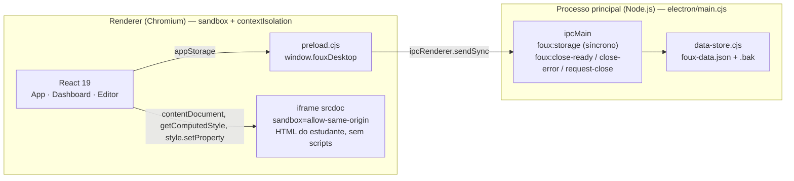
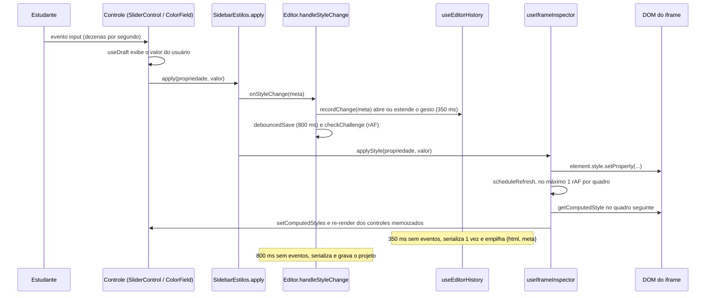
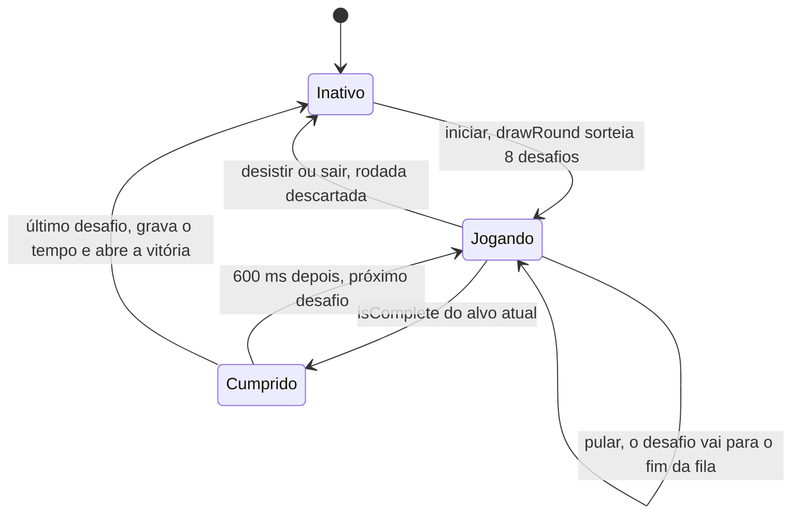

# Dossiê técnico do FOUX para o artigo do TCC — 18/11/2026

Escopo: auditoria somente leitura do repositório FOUX (versão 0.0.4; commit `9708495` acrescido das alterações não commitadas existentes em 18/11/2026), destinada a fundamentar um artigo científico de 20 páginas no padrão SBC. Nenhum arquivo de código-fonte foi criado, alterado ou removido; este dossiê é o único arquivo novo.

**Organização do documento**

0. Método da auditoria, níveis de evidência e correções de premissas
1. Stack tecnológica e justificativa arquitetural
2. Arquitetura, padrões de modularização e engenharia de código
3. Lógica operacional passo a passo
4. Evolução do escopo: funcionalidades agregadas
5. Desafios técnicos enfrentados e soluções implementadas
6. Vulnerabilidades, limitações conhecidas e cortes de escopo
7. Inventário de métricas e de testes
- Apêndice A — Marcadores internos do FOUX
- Apêndice B — Sondas executadas nesta auditoria
- Apêndice C — Mapeamento sugerido para o artigo SBC
- Apêndice D — Índice dos arquivos citados

---

## 0. Método da auditoria, níveis de evidência e correções de premissas

### 0.1 Objeto auditado

O objeto desta auditoria é a árvore de trabalho do repositório em 18/11/2026: o commit `9708495` (13/11/2026) acrescido de alterações não commitadas em 113 arquivos rastreados (+25.890 e −9.919 linhas) e de 36 arquivos ainda não rastreados. Parte significativa das funcionalidades descritas aqui (conta-gotas, cores recentes, índice de `!important`, ativação automática de bordas, seleção em lote no Dashboard e depósito de fontes do histórico) existe apenas nessa árvore. Para a reprodutibilidade exigida em um artigo, recomenda-se registrar essa versão em um commit e em uma tag (por exemplo, `v0.0.4`) e citar esse identificador no texto.

### 0.2 Procedimentos

1. Leitura integral dos cinco módulos de `electron/`, dos arquivos de configuração da raiz e de `src/hooks`, `src/utils`, `src/challenges`, `src/services`, `src/context` e dos componentes do editor; leitura dirigida dos componentes de Dashboard, Perfil e Configurações.
2. Contagens automatizadas (`wc`, `grep`, `node`) de métricas de código, de internacionalização e de uso de APIs.
3. Inspeção do histórico Git (23 commits, de 17/08/2026 a 13/11/2026), com buscas por conteúdo (`git log -S`/`-G`) para datar funcionalidades e localizar código removido.
4. Execução de `npm run lint`, de nove suítes de teste que gravam apenas no diretório temporário do sistema e de `test:desktop:source` (Electron real sobre um build temporário).
5. Benchmark da sidebar (`scripts/bench_sidebar.mjs`) contra um build de produção gerado fora do repositório, em três rodadas, e contra o servidor de desenvolvimento, em uma rodada.
6. Duas sondas descartáveis, mantidas fora do repositório e executadas pelo harness do próprio projeto (Apêndice B).
7. Verificação de integridade: o hash MD5 do `git diff` somado ao conteúdo dos arquivos não rastreados foi idêntico antes e depois de todas as execuções (`5e1e87cd…`), e as datas de `dist/`, `release/qa` e `build/icons` permaneceram inalteradas.

**Não executado.** `test:rc`, que regrava capturas em `release/qa` e alteraria a árvore de trabalho; `test:desktop`, que exige o instalador empacotado, cuja geração está suspensa por decisão do autor; e validação externa do CSS exportado, que exigiria enviar conteúdo a um serviço de terceiros.

**Ambiente de execução.** Windows 11 Pro (build 26300); AMD Ryzen 5 5600GT (12 threads lógicas); 15,4 GB de RAM; Node.js 24.14.1; Google Chrome 157.0.8103.79 em modo headless, controlado pelo Chrome DevTools Protocol (CDP); Electron 44.7.0.

### 0.3 Níveis de evidência

Cada afirmação relevante traz uma marca entre colchetes. As referências `arquivo:linhas` apontam para o código atual (índice com links no Apêndice D).

| Marca | Significado | Uso recomendado no artigo |
|---|---|---|
| **[C]** | Verificado diretamente no código-fonte | Afirmação direta |
| **[E]** | Verificado por execução nesta auditoria (18/11/2026) | Dados de resultados |
| **[H]** | Verificado no histórico Git | Evolução do escopo |
| **[R]** | Registrado em relatório interno de `docs/`, não reexecutado aqui | Citar como medição anterior, com a data |
| **[I]** | Inferência técnica do auditor, não documentada no código | Discussão ou hipótese, nunca como fato medido |

### 0.4 Correções de premissas do roteiro

O roteiro desta auditoria partiu de algumas premissas que o código não confirma integralmente. Ajustá-las no artigo evita contradições diante da banca.

| # | Premissa | O que o repositório mostra | Evidência |
|---|---|---|---|
| 1 | Uso de Tailwind CSS | Tailwind **não está instalado** nem configurado: não há `tailwind.config` nem `postcss.config`. O único `postcss` presente (8.5.31) é dependência transitiva do Vite. A estilização usa CSS puro, variáveis CSS e seletores `[data-theme]`. | [C] `package.json`; [E] `npm ls postcss` |
| 2 | `getElementSelector` dentro de `useIframeInspector` | A função está em `exportCss.js` e só a exportação a usa. A seleção no canvas guarda a referência direta ao nó do DOM, não um seletor. | [C] `exportCss.js:4–27` |
| 3 | Uso de `CSSStyleSheet.insertRule` | Não há chamada a `insertRule` nem a `deleteRule`. O motor de `:hover` lê `sheet.cssRules` (CSSOM) e reescreve todo o `textContent` de um `<style>` dedicado. | [C] `useHoverStyles.js:24–73` |
| 4 | A exportação clona o documento e remove `data-foux-*` | A clonagem com limpeza ocorre em `serializeDocument`, usado na persistência e no histórico. A exportação lê o documento vivo pelo CSSOM e gera regras novas; um teste garante que o CSS resultante não contém marcadores internos. | [C] `useIframeInspector.js:131–145`, `exportCss.js:130–215`; [E] `test:user-html` |
| 5 | Temas Light, Dark e Liquid Glass | São **quatro** temas: Dark (padrão), Light, Solarized Waves e Liquid Glass, rotulado "Debug mode" na interface. `light-comfort.css` é uma camada de cor sobre o Light, não um tema. | [C] `workspaceData.js:4`, `Settings.jsx:8–13`, `pt.json` |
| 6 | Histórico de até 50 snapshots do DOM | São até 50 entradas em `past` e 50 em `future` (2 × `LIMIT`), guardadas como **strings HTML serializadas**, com fontes importadas deduplicadas. Não são objetos DOM. | [C] `useEditorHistory.js:3, 9–31, 73, 117–119` |
| 7 | Gravação síncrona com `sendSync` + `fsync` a cada alteração | O `sendSync` permanece, mas o processo principal só atualiza a memória; o arquivo é regravado uma vez, 250 ms após a última alteração, com `fsync` em cada gravação em disco. | [C] `main.cjs:12–14`, `data-store.cjs:66–114` |
| 8 | "Remoção" da importação de `.css` | A importação de CSS **nunca foi implementada**. Existiu apenas um botão "Importar CSS" que exibia "Função ainda não implementada" (depois, a chave `common.featureComingSoon`), de 14/09 a 09/10/2026. | [H] `dc67eb0`, `46ddfd5`, `f4a0361` |
| 9 | Resposta da sidebar "< 1 ms" | Vale para o **tempo síncrono do handler** em build de produção (média de 0,35 a 0,41 ms). O custo total de thread principal por evento é de cerca de 3 a 3,6 ms, bem abaixo do orçamento de 16,7 ms por quadro. No servidor de desenvolvimento, o handler mede cerca de 1 ms. | [E] seção 7.5 |
| 10 | Pipeline "a 60 fps" | Não há medição de FPS no repositório. O código limita releitura e validação a uma vez por quadro (`requestAnimationFrame`), e o benchmark compara o custo por evento com o orçamento de 16,7 ms. | [C] `useIframeInspector.js:88–111`; [E] |
| 11 | Cores recentes em fila FIFO | O algoritmo **move a cor para o início** (lista por recência), com capacidade 10 e sem duplicatas: uma cor reutilizada volta à primeira posição, e a menos recente sai. O nome do teste usa "FIFO" de forma imprecisa. | [C] `useRecentColors.js:45–59` |
| 12 | Liquid Glass com "lente convexa" | O mapa de deslocamento é de **borda** (*bezel*): curva 34% de cada lado com expoente 2,4 e mantém o centro neutro. | [C] `LiquidGlassEngine.jsx:3–39` |
| 13 | `:hover` "sem sujar o HTML" | O HTML salvo no projeto **mantém** marcadores internos (classe `foux-hover-target-*`, `data-foux-id`, `data-foux-original-style`, `data-foux-gradient-border` e `<style id="foux-user-hover-rules">`), necessários para persistir o estado. A garantia de limpeza vale para o **CSS exportado**; o FOUX não exporta HTML. | [C] `useIframeInspector.js:131–145`; [E] Apêndice B |

---

## 1. Stack tecnológica e justificativa arquitetural

### 1.1 Visão geral

O FOUX é um editor visual de interfaces destinado ao ensino de HTML e CSS. O estudante importa um arquivo HTML, seleciona um elemento no canvas, ajusta propriedades por controles visuais e observa o efeito em tempo real; o resultado pode ser exportado como arquivo `.css`. A aplicação é uma *single-page application* React empacotada como programa desktop com Electron e distribuída como instalador NSIS para Windows x64. Não há servidor, conta de usuário nem telemetria: os dados ficam em um arquivo JSON local [C: `README.md`; a seção 1.4.5 lista os únicos acessos à rede].

### 1.2 Inventário de dependências

Todas as dependências estão em `devDependencies`, e o bloco `dependencies` está vazio por decisão de projeto: o Vite incorpora React, ReactDOM e lucide-react ao bundle de `dist/`, e o instalador não leva `node_modules` [C: `package.json`; E: teste *installer ships no runtime npm packages* de `test_security_desktop.cjs`].

| Pacote | Declarado | Instalado | Papel técnico no FOUX |
|---|---|---|---|
| `react` / `react-dom` | ^19.2.8 | 19.2.8 | Componentes, hooks e renderização (`createRoot`, `createPortal`, `flushSync`) |
| `lucide-react` | ^1.31.0 | 1.31.0 | Ícones SVG como componentes React |
| `vite` | ^8.2.0 | 8.3.5 | Servidor de desenvolvimento e bundler de produção |
| `@vitejs/plugin-react` | ^6.0.4 | 6.0.5 | Transformação de JSX e Fast Refresh |
| `electron` | ^44.7.0 | 44.7.0 | Runtime desktop (Chromium + Node.js) |
| `electron-builder` | ^26.15.3 | 26.18.0 | Empacotamento e instalador NSIS x64 |
| `@resvg/resvg-js` | ^2.6.2 | 2.6.2 | Rasterização do ícone SVG em PNG e ICO |
| `eslint` + `@eslint/js` | ^10.8.0 / ^10.0.1 | 10.8.1 / 10.0.1 | Análise estática de `.js`/`.jsx` |
| `eslint-plugin-react-hooks` | ^7.1.1 | 7.1.1 | Regras de uso de hooks |
| `eslint-plugin-react-refresh` | ^0.5.3 | 0.5.4 | Compatibilidade com Fast Refresh |
| `globals` | ^17.7.0 | 17.9.0 | Globais de navegador para o ESLint |
| `@types/react`, `@types/react-dom` | ^19.2.17 / ^19.2.3 | 19.2.18 / 19.2.4 | Tipos para o editor de código (IntelliSense); o projeto não contém TypeScript |

Ambiente: Node.js `>=24 <25` (`engines`) e `.nvmrc` = 24. **Ausentes por desenho**, informação útil diante da banca: Tailwind CSS, Sass, CSS-in-JS, PostCSS configurado, Redux ou Zustand, React Router, TypeScript, Jest ou Vitest, Playwright ou Puppeteer e bibliotecas de *parsing* de CSS. Os testes de interface usam um harness próprio sobre o CDP [C].

### 1.3 Camada de interface

**React 19.** A interface é composta apenas por componentes funcionais e hooks. Em `src/` há 147 ocorrências de `useCallback(`, 106 de `useState(`, 77 de `useRef(`, 66 de `useEffect(`, 21 de `useMemo(`, 3 de `useLayoutEffect(`, 6 de `useId(` e 3 contextos criados com `createContext` [C, contagem por `grep`]. Vinte componentes, todos da área do editor, são exportados com `React.memo` [C]. Não há roteador: a tela ativa é o estado `currentScreen` de `App.jsx`, e Editor, Configurações e Perfil são carregados sob demanda com `lazy` e `Suspense` [C: `App.jsx:6–8, 325–398`]. A aplicação roda sob `StrictMode` [C: `main.jsx:26–30`].

**Estilização.** O projeto usa CSS puro em 26 arquivos (10.248 linhas físicas): reset e base, layout do Dashboard, editor e controles, componentes compartilhados, perfil, a pasta `styles/themes/` (Dark, Light, Solarized e a camada Light Comfort) e os materiais de vidro (`glass.css`, `LiquidGlass.css`), que implementam o tema Liquid Glass [C]. Os temas redefinem variáveis CSS sob seletores `[data-theme="…"]` aplicados ao `<html>`. Há 145 nomes distintos de propriedades personalizadas, duas propriedades registradas com `@property` (`--glass-mouse-x` e `--glass-mouse-y`), consultas `prefers-reduced-motion` em seis arquivos e `prefers-reduced-transparency` em `glass.css` [C].

A ordem da cascata é explícita: `Dashboard.css` importa base → layout → editor → shared → temas → perfil → controles → fixados, e `main.jsx` acrescenta, por último, Liquid Glass, barras de rolagem, polimento de interação, vidro, refinamentos, logo e `light-comfort.css` [C: `Dashboard.css`, `main.jsx:4–12`]. As 1.159 ocorrências de `!important` em `src/styles/` indicam uma dívida técnica de especificidade, já reconhecida no roadmap interno, que propõe organizar o CSS em `@layer` [C; R: relatório de 15/11].

> Formulação recomendada: "a interface utiliza CSS3 nativo com propriedades personalizadas (*custom properties*) e temas por atributo; não se emprega framework utilitário como o Tailwind CSS".

### 1.4 Build, empacotamento e operação offline

**1.4.1 Vite.** O `base: './'` gera caminhos relativos, condição para o Electron abrir `dist/index.html` via `file://` [C: `vite.config.js:34–37`]. Um plugin próprio injeta uma *Content Security Policy* (CSP) em `<meta>` **apenas no build**, porque o servidor de desenvolvimento usa script inline do React Refresh e WebSocket [C: `vite.config.js:7–32`].

O build divide o código em *chunks* [E: build de produção de 18/11, com nomes de arquivo idênticos aos de `dist/`]:
- principal (`index`): 345.602 bytes (101.944 com gzip);
- `Editor`: 117.379 bytes (36.069 com gzip);
- `exportCss`: 8.146 bytes, carregado só ao exportar, por `import()` dinâmico [C: `Editor.jsx:164`];
- `Profile` (7.601), `Settings` (4.629) e `records` (1.567);
- CSS: 199.804 + 25.349 bytes.

O sufixo `?inline` importa `scrollbars.css` como texto, para injetá-lo no iframe [C: `canvasScrollbars.js:1`].

**1.4.2 electron-builder.** A configuração em `package.json` define [C]:
- `appId` `com.foux.desktop` e alvo NSIS x64 com escolha de pasta (`oneClick: false`), atalhos na área de trabalho e no menu Iniciar e `artifactName` `FOUX-Setup-${version}.${ext}`;
- os manuais PT/ES como `extraResources`, fora do `app.asar`, e a exclusão de `dist/docs/**` do pacote;
- um *hook* `beforePack` (`build/validate-resources.cjs`) que aborta o empacotamento se faltar algum recurso ou se a plataforma não for Windows.

O `app.asar` atual tem 738.979 bytes, e o instalador `release/FOUX-Setup-0.0.4.exe`, 124.989.869 bytes (SHA-256 `5780b328…6770`), gerado em 15/11/2026 a partir do mesmo `dist/` [E].

**1.4.3 Ícones.** `scripts/generate-icons.cjs` lê `build/icon.svg`, ajusta o `viewBox` para reduzir a margem vazia, rasteriza com `@resvg/resvg-js` em 16, 24, 32, 48, 64, 128, 256 e 512 px, verifica se o quadro de 512 px tem pixels coloridos visíveis e monta manualmente o contêiner ICO (cabeçalho `ICONDIR` + entradas de 16 bytes) com quadros PNG de até 256 px [C: `generate-icons.cjs:6–54`]. Um relatório interno antigo cita `public/favicon.svg` como fonte do ícone; o código atual usa `build/icon.svg` [C].

**1.4.4 Pipeline de release e CI.** `npm run dist:win` executa, apenas em Windows: geração de ícones → `vite build` → `electron-builder --win nsis --x64 --publish never` → verificação do artefato (assinatura `MZ`, tamanho mínimo) e gravação do SHA-256 em `release/SHA256SUMS-windows.txt` [C: `build-release.cjs`, `verify-release.cjs`]. No GitHub Actions (`windows-2022`) [C: `.github/workflows/desktop-build.yml`]:
- o job `renderer` roda `npm test` e `build:desktop`;
- o job `package` empacota, verifica o artefato e testa a persistência do pacote;
- o job `draft-release` anexa o instalador a uma *release* em rascunho quando há tag `v*`.

**1.4.5 Operação offline.** A aplicação não depende de servidor próprio. Apenas quatro pontos usam a rede [C]:
- a fonte Inter, carregada do Google Fonts em `index.html`; sem conexão, a pilha `'Inter', -apple-system, BlinkMacSystemFont, 'Segoe UI', sans-serif` recai em Segoe UI no Windows (`index.css:15`);
- a imagem de demonstração do Tutorial, hospedada em `images.unsplash.com` (`tutorialTemplate.js`);
- os recursos externos referenciados pelo próprio HTML do estudante (CDNs, imagens remotas);
- a exportação, que busca folhas externas com `fetch` quando o CSSOM nega acesso (`exportCss.js:43`).

> Formulação recomendada: "o FOUX opera sem servidor e sem conexão; recursos remotos (a fonte da interface, a imagem de exemplo do tutorial e as dependências externas do HTML do estudante) degradam de forma controlada quando não há rede".

### 1.5 Camada de comunicação e segurança desktop

**Modelo de processos.**



**Isolamento.** Toda janela usa `nodeIntegration: false`, `contextIsolation: true` e `sandbox: true`; a principal usa ainda a partição persistente `persist:foux-app`, e `app.enableSandbox()` estende o sandbox a qualquer renderer [C: `main.cjs:19, 82–91, 128–134`]. Executado com o Electron real, o teste confirmou que `require` e `process` não existem na página [E: `test:desktop:source`].

**Ponte mínima.** `contextBridge.exposeInMainWorld('fouxDesktop', …)` publica apenas `requestClose()`, `storage.snapshot()`, `storage.setItem(chave, valor)`, `storage.removeItem(chave)` e `onBeforeClose(callback)` [C: `preload.cjs:20–39`].

**Canais IPC.**

| Canal | Direção | Modo | Função |
|---|---|---|---|
| `foux:storage` | renderer → principal | síncrono (`sendSync`) | Operações `snapshot`, `set` e `remove`; resposta `{ ok, data \| error }` |
| `foux:legacy-storage` | janela de migração → principal | assíncrono | Entrega o `localStorage` de versões antigas |
| `foux:before-close` | principal → renderer | assíncrono | Pede o salvamento antes de fechar |
| `foux:close-ready` / `foux:close-error` | renderer → principal | assíncrono | Confirma o salvamento ou relata a falha |
| `foux:request-close` | renderer → principal | assíncrono | Leva `window.close()` ao aperto de mão de fechamento |

**Validação de origem e de dados.** O processo principal só atende o quadro principal cuja URL, decodificada com `fileURLToPath` e comparada sem diferenciar maiúsculas no Windows, aponta para `dist/index.html`. A comparação anterior, feita sobre o texto da URL, falhava em pastas de instalação com `[`, `]` ou `~`, porque Node e Chromium codificam esses caracteres de formas diferentes [C: `main.cjs:40–43`, `app-url.cjs:4–28`; R: 15/11; E: `test:desktop:source` na pasta `FOUX [teste] ~ ç %41 #1`]. As chaves precisam do prefixo `foux_`, os valores precisam ser strings e a operação precisa constar da lista permitida [C: `main.cjs:60–75`, `data-store.cjs:12–18`].

**Persistência atômica.** O arquivo `foux-data.json` guarda `{ version: 1, data: { foux_*: string } }`. Cada gravação em disco segue a sequência: escrever `foux-data.json.tmp` (modo `0o600`) → `fsyncSync` → copiar o arquivo vigente para `.bak` → `renameSync` do temporário sobre o principal. Assim, uma queda no meio da gravação nunca deixa o arquivo pela metade [C: `data-store.cjs:66–80`].
- **Recuperação.** Na leitura, um arquivo inválido é substituído pelo `.bak` e preservado como `.corrupt-<timestamp>`. Sem `.bak`, o aplicativo recusa iniciar em vez de sobrescrever os dados com um estado vazio [C: `data-store.cjs:44–63`, `main.cjs:252–255`; E: teste *unrecoverable data is not silently overwritten*].
- **Bloqueios do Windows.** Antivírus e indexador causam `EPERM`, `EBUSY` ou `EACCES` transitórios. O código faz até quatro tentativas, com espera síncrona via `Atomics.wait` de 25, 50 e 75 ms (no máximo 150 ms). Uma falha persistente mantém os dados na memória e agenda nova tentativa a cada 5 s [C: `data-store.cjs:4–33, 92–104`].

**Tratamento de caminhos e de nomes.**
- O renderer nunca informa caminhos ao processo principal; o arquivo de dados é fixo dentro de `userData` [C].
- Os únicos arquivos abertos no sistema são os dois manuais, resolvidos a partir de uma lista fixa para `resources/docs/` [C: `manual.cjs:4–17`].
- O nome do CSS exportado é saneado: caracteres de controle e `<>:"/\|?*` viram `_`, pontos e espaços finais são removidos e nomes reservados do Windows (`CON`, `PRN`, `AUX`, `NUL`, `COM1–9`, `LPT1–9`) recebem prefixo [C: `exportCss.js:217–223`].
- O nome de fontes importadas é restrito a `[a-zA-Z0-9\s-]` [C: `StylesTab.jsx:78`].

**Navegação, permissões e instância única.** `will-navigate` é cancelado; `setWindowOpenHandler` nega toda janela nova e só abre, via `shell.openPath`, os manuais; todas as permissões (câmera, microfone etc.) são negadas; e `requestSingleInstanceLock` impede uma segunda instância [C: `main.cjs:45–56, 137–147, 239`].

**CSP de produção.** `default-src 'self'; script-src 'self'; object-src 'none'; form-action 'none'`. Estilos, imagens, fontes, mídia, `connect` e `frame` aceitam `'self' https: http: data: blob: file:`, porque o iframe `srcdoc` herda a política da página e precisa renderizar o HTML do estudante; `style-src` inclui `'unsafe-inline'` [C: `vite.config.js:7–19`; E: `test:desktop:source` — "CSP ativa sem bloquear o HTML do aluno"].

**Isolamento do conteúdo do estudante.** O iframe usa `sandbox="allow-same-origin"` **sem** `allow-scripts`: o JavaScript do HTML importado não executa, e o editor continua acessando o `contentDocument` [C: `EditorCanvas.jsx:74–83`; E: Apêndice B, sonda 1]. Antes da injeção, `neutralizeHtml` remove `<meta http-equiv="refresh">` e qualquer CSP do estudante (que bloquearia as folhas do inspetor) e acrescenta `<base target="_blank">` e um `<meta name="darkreader-lock">` marcado, para que extensões de modo escuro não alterem as cores lidas [C: `EditorCanvas.jsx:7–27`].

**Fechamento sem perda de dados.** O fechamento passa por um aperto de mão em duas fases [C: `main.cjs:149–235`, `main.jsx:15–24`, `Editor.jsx:326–342`]:
1. O evento `close` é cancelado, e o principal envia `foux:before-close`, com prazo de 10 s.
2. No renderer, `flushSync` dispara o evento `foux:before-close`; o Editor serializa o documento aberto, e os efeitos de persistência gravam pelo IPC.
3. O preload responde `foux:close-ready`. O principal executa `store.flush()`, que grava as pendências e regrava uma segunda vez para igualar o `.bak`, e `session.flushStorageData()`, e só então fecha a janela.
4. Em caso de falha ou de fim do prazo, um diálogo localizado oferece "Continuar no FOUX" ou "Fechar sem salvar"; a segunda opção ainda grava o que já chegou ao processo principal.
5. O encerramento do renderer (`render-process-gone`), o fim de sessão do Windows (`session-end`) e `will-quit` também gravam as pendências.

[E: `test:desktop:source` — "gravação no fechamento"; os cinco testes de `test_data_store.cjs`]

### 1.6 APIs nativas do navegador

| API | Onde | Finalidade |
|---|---|---|
| `HTMLIFrameElement` (`srcdoc`, `sandbox`, `contentDocument`, `contentWindow`) | `EditorCanvas.jsx`, `useIframeInspector.js` | Isolar e manipular o HTML do estudante |
| DOM: `querySelectorAll`, `closest`, `classList`, atributos, `cloneNode`, `outerHTML` | Todo o motor | Seleção, marcação e serialização |
| `getComputedStyle` (23 ocorrências) | `styles.js`, `contrast.js`, `eyedropper.js`, `engine.js` | Valor final da cascata para sidebar, contraste, conta-gotas e desafios |
| `CSSStyleDeclaration` (`setProperty` com prioridade, `getPropertyPriority`, `cssText`) | `useIframeInspector.js`, `format.js` | Escrita inline com `!important` seletivo; normalização |
| CSSOM: `document.styleSheets`, `sheet.cssRules`, `CSSRule` (`IMPORT_RULE`, `SUPPORTS_RULE`), `sheet.disabled` | `important.js`, `exportCss.js`, `useHoverStyles.js`, `HoverTab.jsx` | Ler regras do estudante, indexar `!important`, desligar folhas temporariamente |
| `CSS.escape`, `CSS.supports` | `exportCss.js`, `useHoverStyles.js`, `important.js`, `gradientBorder.js` | Seletores seguros; detecção de suporte (por exemplo, `background-clip: border-area`) |
| `requestAnimationFrame` (8 pontos de chamada) | Inspetor, desafios, aba Eventos, overlays, tour, vidro, banner de pasta | Coalescer leituras e escritas em no máximo uma por quadro |
| Web Animations: `element.getAnimations()` | `styles.js:79–84` | Reler estilos quando transições autorais terminam |
| `elementFromPoint`, `caretPositionFromPoint`/`caretRangeFromPoint`, `Range.getClientRects`, `TreeWalker` | `eyedropper.js`, `contrast.js`, `tutorialI18n.js` | Detectar texto sob o cursor e percorrer nós de texto |
| Canvas 2D: `createImageData`/`putImageData`, `drawImage`/`getImageData`, `toDataURL` | `LiquidGlassEngine.jsx`, `imageSampling.js`, `image.js` | Mapa de refração, leitura de pixels de imagens e avatar em WebP |
| `Image.decode`, `crossOrigin = 'anonymous'` | `image.js`, `imageSampling.js` | Decodificação assíncrona; leitura de pixels sob CORS |
| `Blob`, `URL.createObjectURL`, `<a download>` | `exportCss.js:225–234` | Download do `.css` |
| `FileReader` (`readAsText`, `readAsDataURL`) | `Editor.jsx`, `StylesTab.jsx` | Importar HTML e fontes |
| `DOMParser` | `EditorCanvas.jsx`, `tutorialI18n.js` | Neutralizar o HTML e traduzir o tutorial |
| `fetch` + `AbortSignal.timeout(10000)` | `exportCss.js` | Folhas bloqueadas pelo CSSOM e URLs `blob:` na exportação |
| `matchMedia` | `exportCss.js`, `important.js`, `useModal.js`, `LiquidGlassEngine.jsx` | Regras `@media` ativas, movimento reduzido, ponteiro fino |
| `ResizeObserver`, `MutationObserver` | Overlays, tour, tooltips, barras de rolagem | Reposicionar camadas; normalizar `title`; seguir a troca de tema |
| Fullscreen API, Pointer Events (`setPointerCapture`), `<dialog>.showModal()`, atributo `inert` | Editor, HUD, tour, sidebar | Prévia em tela cheia, arraste do HUD, tour modal, acordeões fechados inertes |
| SVG `<filter>` com `feImage` + `feDisplacementMap`; `backdrop-filter: url(#…)` | `LiquidGlassEngine.jsx`, `glass.css` | Refração do Liquid Glass |
| Web Storage e evento `storage` | `appStorage.js`, `useRecentColors.js` | Persistência na versão web; sincronização entre abas |

Não são usados: `window.EyeDropper` (citado apenas em comentário, como alternativa descartada), `insertRule`, Web Workers, IndexedDB e `structuredClone` [C].

---

## 2. Arquitetura, padrões de modularização e engenharia de código

### 2.1 Organização de pastas

```text
src/                         127 arquivos
├── main.jsx, App.jsx        entrada, provedores, estado de domínio e CRUD
├── pages/          (4)      Dashboard, Editor, Profile, Settings
├── components/
│   ├── dashboard/  (14)     cartões, pastas, menus, seleção em lote, modais
│   ├── editor/     (7)      cabeçalho, canvas, overlay, conta-gotas, tour, sidebar
│   │   ├── controls/ (12)   slider, número, cor, gradiente, Box Model, sombra, rótulos
│   │   ├── sidebar/  (4)    abas Estilos, Layout e Eventos + useColorControls
│   │   └── challenges/ (2)  HUD e modal de vitória
│   ├── profile/    (1)      cartão de recordes
│   └── ui/         (7)      modais, toasts, tooltips, logo, motor Liquid Glass
├── hooks/          (15)     inspetor, :hover, histórico, rascunho, persistência, seleção…
├── utils/          (24)     css/ (6), inspector/ (5), exportação, gradientes, tutorial, i18n
├── challenges/     (3)      banco de desafios, motor de sorteio e validação, recordes
├── services/       (2)      adaptador de armazenamento e normalização de dados
├── context/        (1)      idioma (LanguageContext)
├── locales/        (2)      pt.json, es.json
└── styles/         (25)     base, componentes e themes/ (4); mais src/index.css
electron/           (5)      main, preload, data-store, manual, app-url
scripts/            (25)     testes, benchmark, ícones e release
build/                       ícone-fonte e validação pré-empacotamento
docs/                        relatórios técnicos e guias
```

O critério de separação é a natureza do código [C]:
- `components/` e `pages/` contêm apresentação e composição.
- `hooks/` contém controladores com estado e ciclo de vida: inspeção, histórico, persistência, seleção e desafios.
- `utils/`, `challenges/engine.js` e `challenges/pool.js` contêm funções puras ou quase puras, que recebem o documento ou os valores por parâmetro e não dependem do React.
- `services/` isola a fronteira com o armazenamento.
- `electron/` é o único código com acesso ao sistema de arquivos.

### 2.2 Princípio estruturante: a fronteira entre React e o documento do estudante

O React é declarativo e controla apenas a árvore da interface; o documento do estudante é manipulado de forma imperativa dentro do iframe. Se o React renderizasse esse conteúdo, suas reconciliações sobrescreveriam as edições. Por isso o React fornece apenas o contêiner e o atributo `srcDoc`, e toda interação com o documento passa por `useIframeInspector`, que funciona como ponte (*bridge*) [C: `EditorCanvas.jsx:73–83`, `useIframeInspector.js:66–377`].

A regra resultante:
- o estado da interface vive no React;
- o estado do documento vive no DOM do iframe, que é a fonte da verdade;
- o React recebe apenas uma cópia de leitura dos valores computados, atualizada no máximo uma vez por quadro.

### 2.3 Camadas de estado

| Camada | Fonte da verdade | Mecanismo | Exemplo |
|---|---|---|---|
| Documento do estudante | DOM do iframe | `style.setProperty`; `<style>` dedicados | Estilos inline; regras `:hover` |
| Espelho de leitura | Estado `computedStyles` | `getComputedStyle`, no máximo 1× por quadro | Valores mostrados na sidebar |
| Rascunho efêmero do controle | `useDraft`; rascunho de `NumericInput`; texto digitado em `ColorField` | Descartado quando o valor computado alcança o digitado ou quando `resetKey` (elemento + revisão) muda | O slider não "volta" durante o arraste |
| Gesto e histórico | *Refs* de `useEditorHistory` (`past`, `future`, `baseline`, `pending`) | Memento serializado; gesto fechado após 350 ms | Ctrl+Z e Ctrl+Y |
| Domínio | `App.jsx` + `useWorkspaceState` | `useState` + efeitos de persistência | Projetos, pastas, atividades, perfil, tema |
| Preferências auxiliares | Chaves `foux_*` próprias | `appStorage` direto | Idioma, largura da sidebar, seções abertas, cores recentes, recordes |
| Persistência durável | Processo principal | `foux-data.json` atômico (ou `localStorage` na web) | — |

`useDraft` aplica o padrão de estado derivado ajustado durante a renderização: se o valor de origem ou a chave mudam, o rascunho é descartado na mesma renderização, sem efeito adicional [C: `useDraft.js:8–16`]. Uma escrita que não altera o valor computado, como uma largura acima do `max-width`, nunca "alcançaria" a fonte; por isso o descarte também ocorre na troca de elemento [C: `useDraft.js:6–7`; E: `test:user-html` — "rascunho do slider descartado ao trocar de elemento e ao restaurar"].

### 2.4 Padrões de projeto identificados

| Padrão | Implementação no FOUX | Evidência |
|---|---|---|
| Adapter | `appStorage` expõe a interface da Web Storage API tanto sobre o IPC do Electron quanto sobre o `localStorage` | [C] `appStorage.js:1–30` |
| Bridge / Facade | `useIframeInspector` concentra o acesso ao documento do estudante: selecionar, aplicar, serializar, restaurar, fontes, IDs e `:hover` | [C] `useIframeInspector.js:360–376` |
| Memento com coalescência | `useEditorHistory` guarda `{ html, meta }` e agrupa eventos contínuos em um único passo | [C] `useEditorHistory.js:35–123` |
| Internação (*flyweight*) | `createFontPool` troca cada `<style id="foux-font-*">` por uma referência numérica delimitada por U+0000 | [C] `useEditorHistory.js:9–31` |
| Observer / *external store* | `useRecentColors` com `useSyncExternalStore` e evento `storage` | [C] `useRecentColors.js:34–64` |
| Context | Idioma, sessão do conta-gotas, seções da sidebar | [C] `LanguageContext.jsx`, `useEyedropper.js`, `useSidebarSections.js` |
| Máquina de estados | Sessão de desafios: `null` → `playing` ⇄ `passed` → resultado | [C] `useChallengeMode.js:8–72` |
| Regras orientadas a dados (*Strategy*) | Cada desafio carrega um predicado `check`; tour, temas, fontes, *presets* e cores de pasta são tabelas | [C] `pool.js:51–173`, `tutorialTour.js:4–13` |
| *Latest ref* | Handlers estáveis que leem o valor mais recente de uma *ref* (`styles.current`, `onChangeRef`, `checkRef`, `shortcutHandler`) | [C] `useColorControls.js:20–25`, `ColorField.jsx:18–19` |
| Portal | Conta-gotas, tooltip e tour renderizados em `document.body` | [C] `EyedropperOverlay.jsx:202–246` |
| Guardas contra condições de corrida | Verificação de `ownerDocument` e de `isConnected` antes de escrever | [C] `useHoverStyles.js:26`, `useIframeInspector.js:97, 125` |
| Escrita atômica | Temporário + `fsync` + `.bak` + `rename` | [C] `data-store.cjs:66–80` |
| Aperto de mão em duas fases | `before-close` → `close-ready` ou `close-error`, com prazo | [C] `main.cjs:149–235` |

### 2.5 Isolamento de regras puras e testabilidade

As regras de domínio que não exigem React foram extraídas para módulos importáveis tanto pelo navegador quanto pelo Node [C]:

| Módulo | Responsabilidade |
|---|---|
| `utils/css/color.js` | `rgb()` → `#rrggbb`; leitura de alfa; hex + alfa → `rgba()`; normalização de hex digitado |
| `utils/css/contrast.js` | Luminância relativa, razão de contraste, nível WCAG, composição alfa, fundo visível e tom de partida do `:hover` |
| `utils/css/format.js` | Divisão respeitando aspas e parênteses; reescrita de `url()`; formatação didática de regras |
| `utils/css/eyedropper.js`, `imageSampling.js` | Resolução da cor visível em um ponto; amostragem de pixels |
| `utils/inspector/hoverRules.js` | Leitura e montagem de declarações `:hover` |
| `utils/inspector/borders.js` | Lado visível da borda; ativação de estilo e espessura |
| `utils/inspector/important.js` | Índice por documento das declarações `!important` do estudante |
| `utils/gradientBorder.js` | Leitura de gradientes; técnica reversível de borda em gradiente |
| `utils/historyLabels.js` | Metadados e rótulos legíveis do histórico |
| `utils/exportCss.js` | Seletor único, leitura das folhas e geração do CSS |
| `challenges/engine.js`, `pool.js` | Sorteio Fisher–Yates, validação e faixas de matiz |

Dez testes unitários exercitam essas funções no Node, sem navegador: leitura de gradientes, lado da borda, ativação de borda (com *stubs*), cores, contraste, `hoverShade` e o depósito de fontes do histórico [C/E: `test_editor_units.mjs`]. `getElementSelector` e `generateProjectCss` dependem do CSSOM real e são testados de ponta a ponta no Chromium [C/E: `test_editor.mjs`, `test_user_html_editing.mjs`].

### 2.6 Estratégias de otimização de renderização

- **Escrita imediata, leitura agendada.** O estilo chega ao iframe no próprio evento; a releitura (recálculo de estilo + layout) e o `setState` ocorrem no máximo uma vez por quadro [C: `useIframeInspector.js:88–111`].
- **Memoização com handlers estáveis.** `memo` envolve 20 componentes do editor. Os handlers de cor leem os estilos de uma *ref*, de modo que um controle arrastado não re-renderiza os demais, e os grupos `text`, `background` e `border` são memorizados com `useMemo` [C: `useColorControls.js:16–114`].
- **Coalescência em quatro escalas de tempo.** Quadro (rAF, cerca de 16,7 ms) para leitura e validação; gesto (350 ms) para o histórico; pausa (800 ms) para o salvamento automático; e 250 ms no processo principal para a gravação em disco [C].
- **Trabalho redundante evitado.**
  - `appStorage.setItem` não atravessa o IPC quando o valor é idêntico [C: `appStorage.js:13–14`].
  - Os efeitos de persistência ignoram a primeira execução, que apenas regravaria o que acabou de ser lido [C: `useWorkspaceState.js:89–130`].
  - `updateProject` descarta atualizações sem mudança real, preservando `updatedAt` e a ordenação do painel [C: `App.jsx:215–221`].
- **Carregamento sob demanda.** Páginas com `lazy`, exportação por `import()` e CSS do editor importado apenas pela página do editor [C].
- **Relógios únicos.** Um único relógio (`useReducer`, a cada 30 s) atualiza os tempos relativos de todas as atividades; o cronômetro dos desafios vive no HUD, sem re-renderizar o Editor a cada segundo [C: `AtividadeRecente.jsx:62–65`, `ChallengeHud.jsx:17–21`].
- **Vidro dentro do orçamento.** O brilho que segue o cursor é atualizado por rAF, pausa enquanto o botão do mouse está pressionado (arraste de sliders) e fica desligado em dispositivos sem ponteiro fino [C: `LiquidGlassEngine.jsx:50–107`].

### 2.7 Internacionalização (PT-BR e ES-419)

- **Motor de tradução.** `LanguageContext` resolve chaves pontilhadas (como `settings.themes.dark`) com *fallback* para o português e, em último caso, para a própria chave; interpola parâmetros `{nome}`; ajusta o `lang` do `<html>` (`pt-BR` ou `es-419`); formata datas com `toLocaleDateString` e calcula o tempo relativo com regras próprias para cada idioma [C: `LanguageContext.jsx:21–137`].
- **Dicionários.** São 420 chaves em cada idioma, em 16 *namespaces*, com paridade total [E: contagem por script e `test:features`].
- **Atividades.** São gravadas sem idioma (`{ actionKey, params }`) e traduzidas na exibição; registros antigos em texto livre são migrados [C: `App.jsx:68–71`, `activityI18n.js`].
- **Desafios.** Os enunciados ficam no próprio banco, como `{ pt, es }`, para serem carregados apenas com o editor [C: `pool.js:3–5`].
- **Tutorial.** Há dois modelos de HTML. `localizeTutorialHtml` mapeia elemento a elemento os modelos PT e ES e traduz textos, atributos (`alt`, `title`, `aria-label`) e IDs, inclusive dentro de seletores CSS, preservando estilos e edições do estudante; o histórico de desfazer é retraduzido junto [C: `tutorialI18n.js:22–79`, `useEditorHistory.js:177–184`; E: `test:i18n` — "language roundtrip preserving edits"].
- **Diálogos nativos.** O processo principal tem um pequeno dicionário próprio, porque não carrega os *locales* do React [C: `main.cjs:21–38`].
- **Manuais.** Há um PDF por idioma, empacotado como recurso externo [C/E: `test_manual.cjs`].

### 2.8 Sistema de temas

O tema é uma string validada contra a lista `dark | light | solarized | liquid-glass`, gravada em `foux_theme` e aplicada como `data-theme` no `<html>` [C: `workspaceData.js:4, 41–43`, `useWorkspaceState.js:140–143`]. As barras de rolagem do canvas acompanham o tema: o CSS é injetado no iframe com os seletores `[data-theme]` reescritos para `:root` [C: `canvasScrollbars.js:4–15`]. O motor Liquid Glass está descrito na seção 4.6.

---

## 3. Lógica operacional passo a passo

### 3.1 Inicialização, persistência e Dashboard

1. **Processo principal.** `app.enableSandbox()` → `requestSingleInstanceLock()` → `whenReady()` → `createDataStore(userData, { writeDelay: 250 })`, que lê e valida `foux-data.json` ou recupera o `.bak` → `migrateLegacyStorage()`, quando ainda não há arquivo de dados (uma janela oculta lê o `localStorage` antigo, com prazo de 10 s) → `createWindow()` (1280 × 800, mínimo 960 × 640) → `loadURL(pathToFileURL(dist/index.html))` [C: `main.cjs:79–255`].
2. **Preload e *snapshot*.** O preload publica `window.fouxDesktop`, e `appStorage` copia o *snapshot* inteiro para um mapa em memória já no carregamento do módulo; as leituras seguintes não atravessam o IPC [C: `appStorage.js:3–9`].
3. **React.** `main.jsx` registra o salvamento de fechamento e renderiza `<App/>` dentro de `LanguageProvider` e `TooltipProvider`. `useWorkspaceState` inicializa projetos, pastas, atividades, projeto ativo, tema, perfil e dicas com inicializadores preguiçosos que normalizam os dados: IDs únicos do tipo string, nome padrão, `folderId` e `htmlContent` tipados e tema dentro da lista permitida [C: `useWorkspaceState.js:42–87`, `workspaceData.js:15–43`; E: `test_workspace_data.mjs`].
4. **CRUD.** `App.jsx` concentra as operações [C: `App.jsx:81–321`]:
   - pastas: criar (opcionalmente movendo projetos), renomear, mudar a cor, fixar e excluir (os projetos voltam à raiz);
   - projetos: criar vazio ou a partir do Tutorial, abrir, atualizar, renomear, duplicar, mover, fixar e excluir;
   - em lote: fixar, duplicar, mover, mudar a cor e excluir.

   Cada ação registra uma atividade `{ id, actionKey, params, type, timestamp }`, e a lista é limitada a 100 itens [C: `App.jsx:18–19, 68–71`].
5. **Proteção de integridade.** `updateProject` recusa substituir um `htmlContent` existente por um documento sem conteúdo útil (nada além de `DOCTYPE`, `html`, `head`, `body`, `style`, `script` e `base`), situação que ocorre quando o iframe descarrega e serializa um esqueleto vazio [C: `App.jsx:193–213`].
6. **Seleção múltipla.** `useDashboardSelection` mantém `{ kind, ids: Set }` [C: `useDashboardSelection.js:1–53`]:
   - o primeiro item marcado define o tipo (projeto ou pasta) e bloqueia o outro;
   - itens excluídos ou movidos saem da seleção por derivação;
   - `Esc` cancela quando nenhuma camada sobreposta está aberta.

   A barra de ações oferece fixar, desafixar e excluir (com `ModalConfirm`) para os dois tipos, mudar a cor das pastas e duplicar ou mover projetos [C: `BatchActionBar.jsx`, `Dashboard.jsx:226–282`].
7. **Listagem.** Itens fixados aparecem primeiro; pastas são ordenadas por `createdAt` e projetos por `updatedAt`; a busca é por substring do nome, sem diferenciar maiúsculas [C: `Dashboard.jsx:153–165`].
8. **Fechamento.** Segue o aperto de mão descrito na seção 1.5.

### 3.2 Motor de inspeção no iframe (`useIframeInspector`)

1. **Carga.** O HTML do projeto passa por `neutralizeHtml` e é injetado com `<iframe srcDoc sandbox="allow-same-origin" key={documentVersion}>`. Incrementar `documentVersion` recria o iframe, o que acontece ao importar, desfazer e refazer [C: `EditorCanvas.jsx:47–83`, `Editor.jsx:96–103, 292`].
2. **Preparação a cada `load`** [C: `useIframeInspector.js:264–353`]:
   - remove os *listeners* do documento anterior;
   - grava em `data-foux-original-style` o estilo inline original de todo elemento com `[style]`;
   - repinta as bordas em gradiente salvas;
   - injeta `<style id="foux-inspector-styles">` com os contornos de hover (`1.5px dashed`) e de seleção (`2px solid`), aplicados por atributo (`[data-foux-hovered]`, `[data-foux-selected]`) e com `!important`. Usar uma folha separada, em vez de escrever `outline` inline, preserva o `outline` autoral no documento e na exportação [E: `test:editor` — "authored outlines"];
   - zera a seleção.
3. **Interceptação.** São registrados *listeners* na **fase de captura** do `contentDocument` para `mouseover` e `mouseout` (marcação de hover), `click` e `submit`. O clique chama `preventDefault()` e `stopPropagation()`, para que links, botões e formulários do estudante não naveguem, e seleciona `event.target` [C: `useIframeInspector.js:315–343`].
4. **Seleção.** `select(element)` move o atributo `data-foux-selected`, atualiza `selectedElement` e calcula `extractComputedStyles(element, contentWindow)` [C: `useIframeInspector.js:113–121`].
5. **Leitura de volta para a sidebar.** `extractComputedStyles` lê `getComputedStyle` uma vez e devolve um objeto normalizado [C: `styles.js:24–77`] com:
   - cores em `#rrggbb` (formato exigido por `<input type="color">`) e os valores brutos (`_rawColor`, `_rawBg` etc.), que preservam o canal alfa;
   - o gradiente editável e a borda do **primeiro lado visível**, para ler corretamente um `border-left` isolado;
   - os quatro lados de `padding` e de `margin`;
   - o tamanho da caixa de conteúdo (`getBoundingClientRect` menos *padding* e borda);
   - a razão de contraste do texto.
6. **Seletor CSS único (usado pela exportação).** `getElementSelector` testa os candidatos em ordem e devolve o primeiro que `querySelectorAll` confirma ser único [C: `exportCss.js:4–27`]:
   1. `#id`;
   2. `.classe` (ignorando classes `foux-*`);
   3. `tag.classe`;
   4. `tag`;
   5. `tag:nth-of-type(n)`;
   6. recursão `seletorDoPai > local`.

   Todos os nomes passam por `CSS.escape`.
7. **Navegação por IDs (aba Layout).** O inspetor lista os elementos com `id` e a ocorrência de cada um, porque HTML inválido repete IDs; ao escolher um item, o elemento é selecionado e rolado até o centro da área visível [C: `useIframeInspector.js:180–200`; E: `test:user-html` — "IDs repetidos e numéricos"].

### 3.3 Pipeline de edição em tempo real



1. **Evento.** O controle atualiza o rascunho local (`useDraft`) e chama o *handler*, por exemplo `onPx.borderWidth(5)` → `apply('borderWidth', '5px')` [C: `SliderControl.jsx:6–11`, `StylesTab.jsx:58–61`].
2. **Histórico antes da escrita.** `apply` chama primeiro `onStyleChange(meta)`, com `meta = { labelKey, target, from, to }`, e só depois `applyStyle`. Mudar de propriedade ou de elemento fecha o gesto anterior antes que a nova edição alcance o documento; assim, cada passo do histórico descreve uma única mudança [C: `SidebarEstilos.jsx:68–73`, `useEditorHistory.js:81–95`].
3. **Escrita.** `applyStyle` grava o estilo original (na primeira edição) e executa `writeStyle` [C: `useIframeInspector.js:30–62, 123–129`]:
   - `border-radius`: `!important` inline, sem forçar `overflow`;
   - `border-width`, `border-style` e `border-color`: `!important` e ativação automática de estilo e espessura (seção 5.2);
   - borda em gradiente: técnica de camadas (seção 5.3);
   - gradiente de fundo: acrescenta `background-clip: padding-box`, `background-repeat: no-repeat` e `background-size: auto`;
   - demais propriedades: prioridade definida por `importantPriority`, que só usa `!important` quando uma regra `!important` ativa do estudante alcança o elemento [C: `important.js:49–58`].
4. **Releitura agendada.** `scheduleRefresh` agenda um único `requestAnimationFrame`. Se o elemento ainda está conectado ao mesmo documento, relê os estilos computados; se há transições CSS em andamento (`getAnimations()`), relê de novo quando terminam, para que a sidebar não exiba um valor intermediário [C: `useIframeInspector.js:88–111`, `styles.js:79–84`].
5. **Renderização seletiva.** Só os controles cujas *props* mudaram re-renderizam, e o rascunho cai quando o valor computado alcança o digitado (`Object.is`) [C].
6. **Fim do gesto (350 ms).** `commit()` serializa o documento uma única vez, compacta as fontes e compara o resultado com a linha de base. Se houver diferença, empilha `{ html: linhaDeBase, meta }` em `past` (limite de 50), esvazia `future` e publica `canUndo`, `canRedo` e os rótulos [C: `useEditorHistory.js:65–79`].
7. **Salvamento automático (800 ms).** `serializeDocument` → `onUpdateProject({ htmlContent })` → `setProjects` → efeito `saveToStorage('foux_projects', …)` → `appStorage.setItem` → `sendSync` → memória do processo principal → disco, 250 ms depois [C: `Editor.jsx:202–211`, `useWorkspaceState.js:96–102`].
8. **Desfazer e refazer.** `Ctrl/⌘+Z` desfaz; `Ctrl/⌘+Y` e `Ctrl/⌘+Shift+Z` refazem. O atalho é ignorado em campos de formulário, durante composição IME e com o tour aberto, e é registrado tanto na janela quanto no documento do iframe, porque teclas digitadas dentro do iframe não chegam à janela do editor [C: `useEditorHistory.js:128–163`]. `travel` fecha o gesto pendente, move o retrato atual para a outra pilha, liga a trava `restoring` (que impede gravar no histórico durante a restauração) e recria o iframe com o HTML restaurado; no `load`, `documentLoaded` define a nova linha de base [C: `useEditorHistory.js:108–154`].
9. **Rótulos legíveis.** `historyActionLabel` compõe dicas como "Desfazer: Cor de fundo (#000000 0% → #eef2ff) — div#cartao" [C: `historyLabels.js:56–63`; E: Apêndice B, sonda 2].

### 3.4 Motor de pseudoclasses (`:hover`)

1. **Problema e estratégia.** Estilo inline não expressa pseudoclasses. Cada elemento editado recebe uma classe própria, `foux-hover-target-<8 caracteres aleatórios>`, e um `data-foux-id`; as regras ficam num único `<style id="foux-user-hover-rules">`, salvo junto com o documento (o Tutorial já traz esse elemento declarado) [C: `useHoverStyles.js:6–20`].
2. **Estado inicial da aba Eventos.** A aba lê as regras existentes do elemento, juntando seletores atuais e legados (classe, `data-foux-id` e `#id`), e as converte em `{ bg, bgColor, bgGradient, text, textColor, scale, scaleValue, shadow, shadowX/Y/Blur/Opacity }` [C: `useHoverStyles.js:76–98`, `hoverRules.js:16–47`]. A cor sugerida para o fundo é o fundo visível deslocado 15% em direção ao preto ou ao branco, conforme o que der mais contraste. Ela é calculada com a folha de hover desligada (`sheet.disabled = true`), porque o mouse costuma estar sobre o elemento logo após o clique que o selecionou [C: `HoverTab.jsx:20–34`, `contrast.js:76–81`].
3. **Escrita coalescida.** Cada ajuste atualiza uma *ref* e agenda um `flush` por rAF, o que limita a reescrita da folha a uma por quadro. A desmontagem da aba executa o `flush` pendente, e apenas abrir a aba, sem agir, não altera o documento [C: `HoverTab.jsx:69–105`].
4. **Montagem das declarações.** Todas recebem `!important`, para que a prévia vença os seletores do estudante, e ganham `transition: all 0.25s ease`. Um fundo sólido sobre um elemento com imagem ou gradiente acrescenta `background-image: none` [C: `hoverRules.js:49–81`].
5. **Injeção.** `injectHoverStyles` [C: `useHoverStyles.js:22–73`]:
   - aborta quando o elemento pertence a outro documento (proteção contra o desfazer que trocou o iframe);
   - lê as regras existentes pelo CSSOM (`sheet.cssRules`), que já ignora comentários e normaliza seletores;
   - remove *aliases* legados;
   - grava ou remove a regra atual;
   - normaliza as declarações com um `CSSStyleDeclaration` descartável;
   - **reescreve todo o `textContent`** da folha.
6. **Modo prévia e tela cheia.** `setPreviewMode(true)` desliga a folha do inspetor (`sheet.disabled`) e faz os *listeners* ignorarem o mouse; o canvas entra em tela cheia, com uma alternativa fixa quando a API não está disponível [C: `useIframeInspector.js:147–152`, `Editor.jsx:108–157`; E: `test:editor`].
7. **Exportação do `:hover`.** Os seletores `.foux-hover-target-x:hover` são reescritos para `seletorÚnico:hover`, e o `!important` só permanece quando há conflito com regras base ou edições [C: `exportCss.js:196–211`; E: Apêndice B — `.btn:hover { transform: scale(1.1); transition: 0.25s; }`].

### 3.5 Serialização (persistência) e exportação de CSS

O FOUX tem dois *pipelines* distintos, que o artigo deve diferenciar.

**(a) Serialização para persistência e histórico (`serializeDocument`)** [C: `useIframeInspector.js:131–145`]:
1. Recusa documento vazio (o `about:blank` da desmontagem).
2. Clona a raiz com `doc.documentElement.cloneNode(true)`.
3. Remove do clone a folha do inspetor, a das barras de rolagem, as folhas temporárias da exportação (`[data-foux-export-parser]`) e o `meta` de bloqueio do Dark Reader (`[data-foux-darkreader-lock]`).
4. Remove `data-foux-hovered` e `data-foux-selected`.
5. Retorna `<!DOCTYPE html>\n` + `outerHTML`.

Os marcadores de estado (`data-foux-original-style`, `data-foux-gradient-border`, `data-foux-id`, as classes `foux-hover-target-*`, `<style id="foux-user-hover-rules">` e `<style id="foux-font-*">`) são **mantidos de propósito**, porque deles dependem o "Restaurar elemento", a reabertura do projeto e a reedição do `:hover` [C; E: Apêndice B].

**(b) Exportação (`generateProjectCss`)** [C: `exportCss.js:130–215`]:
1. **Coleta.** Percorre os `<style>` e `<link rel="stylesheet">` do documento vivo, ignorando as folhas do inspetor e das barras de rolagem e as folhas desativadas.
2. **Leitura recursiva (`readRules`).** Segue `@import` com detecção de ciclos, preserva `@media`, `@supports` e `@layer` como blocos aninhados e marca as regras inativas pelo `matchMedia` e pelo `CSS.supports` do momento. Quando o CSSOM nega acesso (folha de outra origem), tenta `fetch` com prazo de 10 s, reescreve `url()` e `@import` para URLs absolutas e interpreta o texto num `<style media="not all">` temporário e marcado; se a tentativa falhar, emite `@import url(...)` [C: `exportCss.js:36–90`].
3. **Edições.** Para cada elemento com `[style]` [C: `exportCss.js:150–195`]:
   - calcula o seletor único;
   - remove as declarações sem `!important` que uma regra `!important` do estudante já anularia;
   - marca `!important` apenas quando necessário: valor diferente do inline original (que continua no HTML do estudante), conflito com regra mais específica ou com pseudoclasse, `!important` do estudante ou `!important` no inline original;
   - **funde** a declaração na regra autoral de mesmo seletor quando nenhuma regra posterior disputa a propriedade; do contrário, cria uma regra nova.
4. **Especificidade.** Usa uma contagem heurística, por expressões regulares, de IDs, de classes/atributos/pseudoclasses e de tipos, descrita no código como "comparação conservadora" [C: `exportCss.js:97–112`].
5. **`:hover`.** Reescrita descrita na seção 3.4.
6. **Ordem de saída.** `@import` externos → regras autorais → edições → regras de `:hover`; o `@import` precisa ficar no topo [C: `exportCss.js:212`].
7. **Formatação didática (`formatRule`).** Indentação de dois espaços, um seletor por linha, cores `rgb()` opacas convertidas para hex, `0px` reduzido a `0`, *shorthands* preservados por `cssText`, propriedades personalizadas intactas e nenhum comentário, já que o CSSOM não os preserva [C: `format.js:24–74`; E: `test:editor` — "educational CSS uses short selectors, formatted blocks, hexadecimal colors, shorthands and no unnecessary !important or comments"].
8. **Recursos locais.** URLs `blob:` são embutidas como *data URLs* [C: `exportCss.js:114–128`].
9. **Download.** `Blob` (`text/css;charset=utf-8`) → `URL.createObjectURL` → `<a download>` com nome saneado → `revokeObjectURL` após 1 s [C: `exportCss.js:225–234`].

**Propriedade de corretude verificada.** O CSS exportado, reaplicado sobre o HTML **original** do estudante (sem nenhum atributo do FOUX), reproduz bordas, `!important`, arredondamentos e fundos, e não contém `foux-hover-target-`, `data-foux` nem `overflow: hidden` [E: `test:user-html` — "CSS exportado reaplicado no HTML original reproduz bordas, !important, radius e fundos"].

> **Sobre "padrão W3C".** O CSS é produzido pela serialização do CSSOM do próprio navegador e segue a sintaxe CSS padrão. Esta auditoria **não** o submeteu ao W3C CSS Validator. Para afirmar conformidade no artigo, recomenda-se validar o CSS exportado do Tutorial e registrar o resultado; construções como `@layer` e valores recentes podem gerar avisos em validadores.

---

## 4. Evolução do escopo: funcionalidades agregadas

### 4.0 Linha do tempo

Datas obtidas pela primeira ocorrência do conteúdo no histórico (`git log -S`), e não pela data em que cada arquivo surgiu no caminho atual, porque arquivos foram movidos ao longo do projeto [H].

| Data | Commits | Marco |
|---|---|---|
| 17/08/2026 | `753f126`, `615d633`, `6c9618c` | Início do projeto; tela ainda não funcional |
| 14/09 | `dc67eb0`, `f238150` | Tela do editor, com gradientes lineares e botões-placeholder "Salvar" e "Importar CSS"; pastas no menu principal |
| 15/09 | `222a1f3` | Inspeção pelo `contentDocument` do iframe; pastas, histórico e configurações; tema Solarized |
| 23–24/09 | `0d20e5b`, `e841875`, `46ddfd5`, `ee3ec39` | Internacionalização (`LanguageProvider`), temas, perfil e hovers |
| 29–30/09 | `615df26`, `67c8770`, `a6cd005` | Desfazer/refazer, folha dedicada de `:hover`, tema Liquid Glass, primeira versão do Tutorial, itens fixados |
| 09/10 | `f4a0361` | FAQ e manual; **exportação de CSS** (`exportCss.js`, 305 linhas) com o retrato `data-foux-original-style`; remoção de "Importar CSS" e "Salvar Como" |
| 13/10 | `9ff215c` | Tour guiado (`TOUR_STEPS`), borda em gradiente, polimento do Liquid Glass |
| 15/10 | `c06a74f` | Tradução ES concluída; armazenamento desktop (`createDataStore`) e aperto de mão de fechamento; primeiro executável |
| 27–28/10 | `9db082f`, `09165f5` | Barras de rolagem por tema; revisão de design e de heurísticas de usabilidade |
| 05/11 | `831baeb` | Ajustes de área de clique e de degradê |
| 13/11 | `9c7e9bd` e seguintes | `useDraft` e otimização da sidebar; contraste WCAG; Box Model e overlay; Modo Desafios; refração SVG do Liquid Glass |
| Após 13/11 | (não commitado) | Auditoria multiagente (15/11); conta-gotas; cores recentes; seleção em lote; índice de `!important`; ativação de bordas; depósito de fontes do histórico |

São 23 commits: 3 em agosto, 10 em setembro, 5 em outubro e 5 em novembro.

### 4.1 Indicador de contraste WCAG em tempo real

**Cálculo** [C: `contrast.js:23–110`]:

```text
canal linear:  c' = c/255;  c_lin = c' ≤ 0,04045 ? c'/12,92 : ((c' + 0,055)/1,055)^2,4
luminância:    L = 0,2126·R_lin + 0,7152·G_lin + 0,0722·B_lin
razão:         CR = (L_mais_clara + 0,05) / (L_mais_escura + 0,05)
composição α:  C = α·C_topo + (1 − α)·C_base
```

- **Fundo efetivo.** A partir do elemento, o algoritmo sobe pelos ancestrais acumulando camadas (preenchimentos e paradas de gradiente) até encontrar um fundo opaco, com o branco como base. Cada parada de gradiente vira um candidato, e a razão informada é a **mínima**, isto é, o pior caso ao longo do degradê. Texto semitransparente é composto sobre cada fundo antes da comparação [C: `contrast.js:53–69, 92–97`].
- **Texto grande.** ≥ 24 px, ou ≥ 18,66 px com peso ≥ 700, correspondentes a 18 pt e a 14 pt em negrito [C: `contrast.js:98–101`].
- **Níveis.** Texto normal: AA ≥ 4,5 e AAA ≥ 7. Texto grande: AA ≥ 3 e AAA ≥ 4,5. Texto normal entre 3 e 4,5 recebe o estado "large", ou seja, só passaria como texto grande [C: `contrast.js:104–110`].
- **Arredondamento conservador.** A razão é truncada em uma casa decimal (`Math.floor(r·10)/10`): um par de 4,46:1 aparece como 4,4:1 e nunca é aprovado por arredondamento [C: `useColorControls.js:97–100`, `ContrastBadge.jsx:8–9`].
- **Onde aparece.** O selo acompanha os controles de cor do texto e de fundo e é recalculado no mesmo quadro da releitura dos estilos [C].
- **Nota técnica para a banca.** O limiar 0,04045 é o da norma sRGB (IEC 61966-2-1); o texto do WCAG 2.0/2.1 cita 0,03928. Para canais de 8 bits a diferença é nula: 10/255 ≈ 0,0392 fica abaixo dos dois limiares, e 11/255 ≈ 0,0431, acima dos dois [I, verificável aritmeticamente].
- **Limitação.** Imagens de fundo (`url()`) e `text-shadow` não entram no cálculo; sobre uma foto, a razão considera a cor de preenchimento do elemento ou de um ancestral [C: `contrast.js:43–51`; I: consequência].

### 4.2 Modo Desafios gamificado (exclusivo do Tutorial)

- **Visibilidade.** O botão só é renderizado quando o projeto aberto é o Tutorial, e uma rodada não inicia enquanto o tour guiado está aberto [C: `EditorHeader.jsx:77–107`, `Editor.jsx:247–254`].
- **Banco.** São 24 desafios em 8 categorias (cor, gradiente, tipografia, Box Model, bordas, sombra, `:hover` e layout), três por categoria. Cada desafio traz `id`, `category`, alvos (IDs nos modelos PT e ES), enunciado `{ pt, es }` e um predicado `check` [C: `pool.js:6–173`].
- **Sorteio.** `drawRound` [C: `engine.js:42–53`]:
  1. descarta os desafios cujo alvo não existe ou que o documento já cumpre;
  2. embaralha as categorias e escolhe, em cada uma, o primeiro desafio de uma lista embaralhada;
  3. completa as vagas com sobras de outras categorias, se alguma se esgotar;
  4. embaralha a ordem final e corta em `ROUND_SIZE = 8`.

  O embaralhamento é o Fisher–Yates na variante de Durstenfeld, aplicado sobre uma cópia, em O(n) [C: `engine.js:7–15`]. Com o banco intacto há 3⁸ × 8! = **264.539.520** rodadas distintas, equiprováveis sob um gerador uniforme [I: cálculo a partir do código]. O gerador é `Math.random`, adequado à gamificação, sem finalidade criptográfica.
- **Validação automática.** `isComplete` lê o `getComputedStyle` de um único elemento (o alvo do desafio atual), além do estado da borda em gradiente e das regras de `:hover`, e aplica o predicado [C: `engine.js:25–40`]. As tolerâncias são:
  - cor por faixa de matiz HSL, com saturação ≥ 0,3, luminosidade entre 0,12 e 0,88 e alfa ≥ 0,5 [C: `pool.js:26–43`];
  - mínimos numéricos, como `font-size` ≥ 32 px;
  - ângulo de gradiente com ±5° [C: `pool.js:80`].
- **Agendamento.** Cada edição chama `checkChallenge`, que agenda no máximo uma validação por quadro e só age com uma rodada ativa; se uma transição atrasar o valor computado, a validação se repete ao fim dela [C: `useChallengeMode.js:31–56`].
- **Ciclo de vida.**



- **Cronômetro.** O HUD atualiza o relógio a cada 1 s; o tempo final é `passedAt(último) − startedAt` [C: `ChallengeHud.jsx:17–26`, `useChallengeMode.js:57–66`].
- **Modal de vitória.** Fecha sozinho após 30 s (`AUTO_CLOSE_MS = 30000`), com uma barra regressiva animada em CSS pela mesma duração; `Esc` e o botão também fecham [C: `ChallengeVictory.jsx:7–43`].
- **Recordes.** `foux_challenge_records` guarda `{ best, runs }`, com as 50 últimas rodadas completas e a marcação de recorde; o melhor tempo fica à parte para não se perder no corte da lista. O Perfil exibe o melhor tempo (MM:SS), a data, o número de rodadas e o histórico [C: `records.js:3–32`, `ChallengeRecordCard.jsx`]. Rodadas parciais nunca são gravadas [C: `useChallengeMode.js:8–10`].
- **Apoio ao estudante.** "Destacar alvo" seleciona o elemento e exibe um contorno por 1,6 s, desenhado fora do documento do estudante. O HUD é arrastável com `setPointerCapture` e pode ser recolhido [C: `Editor.jsx:256–262`, `CanvasOverlay.jsx:3, 101–109`, `ChallengeHud.jsx:28–53`].

### 4.3 Conta-gotas restrito ao canvas (*DOM-scoped eyedropper*)

- **Por que não `window.EyeDropper()`.** O motivo está documentado no código: a API nativa amostraria a tela inteira, inclusive a interface do FOUX [C: `EyedropperOverlay.jsx:68–70`]. A abordagem pelo DOM traz duas vantagens adicionais [I]:
  - o resultado é semântico: o selo mostra se a cor veio de texto, borda, imagem ou fundo e a tag de origem;
  - a amostra não é contaminada pelos contornos de inspeção nem pelo cursor.
- **Mecânica** [C: `EyedropperOverlay.jsx`, `eyedropper.js:112–160`]:
  1. Uma camada do editor cobre apenas a área de conteúdo do iframe, preservando as barras de rolagem. Cliques fora do canvas são bloqueados; `Esc` cancela; `Shift` alterna entre texto e fundo; a roda do mouse é repassada ao contêiner rolável sob o cursor; e cliques subsequentes são descartados por 500 ms para não alterar a seleção.
  2. A amostragem é agendada por rAF. `elementFromPoint` encontra o elemento, e o fundo do `<body>` propagado ao `<html>` é tratado.
  3. A cor é resolvida nesta ordem:
     - **texto** sob o cursor, via `caretPositionFromPoint` ou `caretRangeFromPoint` + `getClientRects`;
     - **borda**, por teste geométrico contra as espessuras;
     - **imagem**: `` com `object-fit` e `object-position`, ou camada `url()` de `background-image` com `size`, `position` e `repeat`;
     - **preenchimento SVG** (`fill`);
     - **fundo visível**, subindo pela árvore DOM e compondo transparências até um fundo opaco, com o branco da página como base.
  4. A `opacity` do elemento e dos ancestrais entra na composição.
- **Pixels de imagem** [C: `imageSampling.js`]. A imagem é desenhada num canvas (lado máximo de 2048 px) e lida com `getImageData`. Imagens de outra origem sem CORS "contaminam" o canvas; o código tenta uma nova carga com `crossOrigin = 'anonymous'` e, se ainda falhar, sinaliza `blocked`, usa a cor de fundo e avisa no selo. Há um cache de 24 entradas, com descarte da menos recente.
- **Aplicação.** A cor escolhida entra em um único passo de desfazer e na lista de cores recentes [C: `ColorField.jsx:37–44`; E: `test:color-tools` — "Conta-gotas: amostra só o canvas, resolve texto/fundo/gradiente e aplica sem trocar a seleção"].

### 4.4 Paleta de cores recentes

- **Estrutura.** Lista por recência com capacidade 10 (`RECENT_COLORS_LIMIT`), hex normalizado em minúsculas e sem duplicatas. `addRecentColor` coloca a cor no início e remove a ocorrência anterior; se a cor já é a primeira, nada muda [C: `useRecentColors.js:5–6, 45–59`]. É uma política de descarte da cor usada há mais tempo (LRU), e não FIFO estrito (correção 11 da seção 0.4).
- **Trava anti-spam.** Durante o arraste do seletor nativo, os eventos `input` aplicam a cor ao elemento, mas só atualizam uma pendência local. A cor entra na paleta apenas quando a escolha é confirmada: evento nativo `change`, `Enter`, `blur` ou desmontagem do campo. Amostras do conta-gotas e cliques em cores recentes entram de imediato [C: `ColorField.jsx:21–44`].
- **Compartilhamento.** Um *store* externo (`useSyncExternalStore`), gravado em `foux_recent_colors`, alimenta todos os seletores de cor e reflete alterações feitas em outra aba pelo evento `storage` [C: `useRecentColors.js:22–64`; E: `test:color-tools`].

### 4.5 Diagrama interativo de Box Model e overlay no canvas

- **Edição.** Há campos *shorthand* de `padding` e `margin` (com o marcador "vários" quando os lados diferem) e um diagrama aninhado no estilo do DevTools, com um campo por lado. Um botão por propriedade liga ou desliga o vínculo entre os lados; o estado inicial é "ligado" quando os quatro lados são iguais. Com o vínculo ligado, o FOUX escreve o *shorthand*; desligado, a propriedade longa do lado (`paddingTop` etc.) [C: `BoxModelEditor.jsx:46–120`]. O centro do diagrama mostra o tamanho do conteúdo (L × A).
- **Overlay.** Passar o mouse ou focar uma área informa ao Editor qual caixa destacar (`margin` ou `padding`). `CanvasOverlay` mede o elemento (`getBoundingClientRect` + `getComputedStyle`), desenha as faixas de margem e de *padding* com as espessuras reais e acompanha rolagem e redimensionamento (rAF + `ResizeObserver`). Tudo é desenhado no editor, **sobre** o iframe: o documento do estudante e a exportação nunca recebem marcação auxiliar [C: `CanvasOverlay.jsx:7–64`].

### 4.6 Controle de estado da interface

- **Restaurar elemento.** Devolve o elemento ao estilo inline registrado em `data-foux-original-style` na primeira abertura do documento, desfaz a borda em gradiente (restaurando as propriedades pintadas) e limpa as regras de `:hover`. É um único passo de desfazer (`recordAction`) e incrementa uma revisão que ressincroniza os controles [C: `useIframeInspector.js:204–228`, `Editor.jsx:220–230`].
- **Limpar tela.** Pede confirmação num `ModalConfirm` (`role="alertdialog"`, foco inicial em "Cancelar", `Esc` fecha) e aplica `restoreAll`: todos os elementos voltam ao inline original, as bordas em gradiente saem, a folha de `:hover` é esvaziada e as fontes importadas são removidas. Também é um único passo, de modo que um Ctrl+Z traz a página inteira de volta [C: `Editor.jsx:232–245`, `useIframeInspector.js:230–262`, `useModal.js:26–27`; E: `test:user-html` — "Restaurar elemento, Limpar tela e desfazer de cada um"].
- **Acordeões persistidos por projeto.** As seções começam fechadas e ficam `inert` enquanto fechadas. As abertas são gravadas em `foux_sidebar_sections` como `{ idDoProjeto: { seção: true } }`. O registro de um projeto passa ao fim da ordem sempre que é regravado, e os mais antigos saem acima de 100 projetos; o estado de um projeto excluído é apagado. O tour abre apenas a seção do passo atual [C: `useSidebarSections.js:4–71`, `CollapsibleSection.jsx:5–14, 37`; E: `test:color-tools` — "Seções da sidebar iniciam fechadas e são restauradas por projeto"].
- **Histórico legível.** Cada passo carrega `{ labelKey, target, from, to }`, com valores formatados (hex, hex + porcentagem de alfa, `linear-gradient(Ndeg)`, texto truncado em 26 caracteres) e o alvo descrito como `tag#id` ou `tag.classe`. A descrição aparece como dica dos botões Desfazer e Refazer [C: `historyLabels.js`].
- **Motor Liquid Glass.**
  - *Mapa de deslocamento*, gerado uma vez num `<canvas>` de 128 × 128 [C: `LiquidGlassEngine.jsx:3–39`]:

    ```text
    u, v ∈ [−1, 1];  bend(t) = sinal(t) · max(0, (|t| − 0,66) / 0,34)^2,4
    (dx, dy) = (bend(u), bend(v));  k = max(1, ‖(dx, dy)‖)
    R = 128 − 127·dx/k;  G = 128 − 127·dy/k;  B = 128;  A = 255
    ```

    O centro é neutro (R = G = 128), a curvatura cresce perto das bordas, e os cantos curvam na diagonal "como um *squircle*" (comentário do código).
  - *Filtro SVG*: o mapa é exportado como *data URL* e usado num `<filter>` com `feImage` + `feDisplacementMap` (`xChannelSelector="R"`, `yChannelSelector="G"`), em duas intensidades: `scale` 38 (`foux-liquid-refraction`) e 18 (`foux-liquid-subtle`) [C: `LiquidGlassEngine.jsx:41–48, 114–117`]. Pela definição do filtro, cada pixel é deslocado de `scale·(C/255 − 0,5)` em cada eixo.
  - *Aplicação*: `backdrop-filter: … url(#foux-liquid-refraction)` nas superfícies de vidro [C: `glass.css:28–29, 172, 224`].
  - *Luz do cursor e acessibilidade*: o brilho é posicionado pelas propriedades `--glass-mouse-x` e `--glass-mouse-y`. Com `prefers-reduced-transparency`, os temas comuns passam a usar superfícies sólidas; o Liquid Glass fica de fora por decisão de projeto [C: `glass.css`; R: 15/11].

---

## 5. Desafios técnicos enfrentados e soluções implementadas

### 5.1 Gargalo de desempenho na sidebar (*layout thrashing*)

- **Problema.** Antes da otimização, cada evento `input` executava, de forma síncrona, três operações custosas [R: relatório de 13/11]:
  1. `serializeDocument()`, que clona o documento e gera o `outerHTML`, incluindo fontes em base64;
  2. uma leitura de `getComputedStyle` com layout forçado;
  3. um re-render de todo o Editor.

  O p95 do seletor de cor (20,7 ms) ultrapassava o orçamento de 16,7 ms por quadro, e o usuário percebia engasgos.
- **Solução.** Escrita imediata com releitura por rAF; histórico com um retrato por gesto (350 ms); salvamento automático após 800 ms de pausa; `useDraft` para o controle não "pular"; `memo` com handlers estáveis; aba Eventos com no máximo uma reescrita da folha por quadro [C, seções 2.6 e 3.3].
- **Resultados.**

| Medição | Seletor de cor (média / p95) | Slider de borda (média / p95) | Fonte |
|---|---|---|---|
| Antes da otimização (fonte de 600 KB, 300 elementos, 120 eventos) | 6,93 / 20,7 ms | 4,00 / 10,1 ms | [R] 13/11 |
| Depois da otimização (mesmo cenário) | 0,35 / 0,5 ms | 0,48 / 0,7 ms | [R] 13/11 |
| **Handler síncrono, build de produção, 3 rodadas** (fonte de 800 KiB, 300 elementos, 120 eventos) | **0,35–0,38 / 0,50–0,60 ms** | **0,40–0,41 / 0,50 ms** | [E] 18/11 |
| Custo total de thread principal por evento (mesmo cenário) | 2,97–3,15 / 3,74–4,30 ms | 3,45–3,63 / 3,63–3,92 ms | [E] 18/11 |

Pelos números de 13/11, a média do handler caiu cerca de 20 vezes no seletor de cor (6,93 → 0,35 ms) e cerca de 8 vezes no slider (4,00 → 0,48 ms); o p95 caiu cerca de 41 e 14 vezes, respectivamente [R, cálculo].

- **Interpretação correta do "< 1 ms".** O valor se refere ao **tempo síncrono do handler** (do evento até a escrita no DOM e o agendamento do restante), em build de produção. O custo completo por evento, que inclui recálculo de estilo, layout e render do React no quadro seguinte, fica entre 3 e 3,6 ms em média, cerca de um quinto do orçamento de 16,7 ms. O fechamento de um gesto (retrato do histórico + salvamento) custa de 8,0 a 8,8 ms e ocorre uma vez por gesto [E]. No servidor de desenvolvimento, com o React em modo dev, o handler mede de 0,92 a 1,01 ms em média, e o total, de 8,25 a 8,60 ms [E]. Detalhes na seção 7.5.

### 5.2 Conflito de bordas (`border-style: none`)

- **Problema.** Com `border-style: none` ou `hidden`, padrão do navegador e efeito de *resets* como `border: 0`, a espessura computada é 0 e a cor não aparece. Por isso, alterar a espessura ou a cor de um elemento sem borda prévia "não fazia nada". Uma borda apenas à esquerda também era lida como 0 px e `#000000`, porque o código consultava o lado de cima [R: 15/11; C: `borders.js:15, 21`].
- **Solução** [C: `borders.js`, `useIframeInspector.js:44–54`]:
  - a sidebar lê o primeiro lado visível com espessura (`borderSide`);
  - uma espessura > 0 ativa `border-style: solid` quando nenhum lado está visível (`revealBorderStyle`);
  - uma cor com alfa > 0 ativa o estilo e, se a espessura for 0, aplica 3 px, valor do `medium` do navegador (`revealBorderWidth`);
  - opacidade 0 não cria borda;
  - a decisão lê o elemento, e não o estado do React, que pode estar um quadro atrás.
- **Validação** [E]: `test_editor_units` — "revealBorderStyle/revealBorderWidth só escrevem quando a borda está invisível"; `test:user-html` — "cor de borda revela estilo e espessura, reset border: 0, opacidade zero e um passo de desfazer" e "borda de um lado só lida e editada sem ganhar os outros lados".

### 5.3 Vazamento de subpixel (*color bleeding*) e transparências

- **Disco de ângulo do gradiente.** Uma franja colorida aparecia na borda serrilhada do círculo. A correção combina `background-clip: padding-box`, `isolation: isolate`, um anel de 1 px em `box-shadow` na cor do painel de cada tema ("sela a borda serrilhada do disco sem cortar a alça de arrastar") e o disco interno recuado 10 px [C: `editor-controls.css:167–195`; H: `831baeb`, "ajustes de hitbox e degradê"]. A inspeção visual ampliada desse disco ficou pendente na auditoria de 15/11 [R].
- **Borda em gradiente.** CSS não admite gradiente em `border-color`. O FOUX pinta duas camadas de `background` [C: `gradientBorder.js:102–148`]:
  - conteúdo: as imagens autorais mais `linear-gradient(cor, cor)`, recortadas em `padding-box`;
  - borda: o gradiente, recortado em `border-box` (ou em `border-area`, quando suportado), com `background-origin: border-box`;
  - complemento: `border-color: transparent`, `border-style: solid` e `border-image: none`.

  Dois comentários registram as correções de vazamento: a camada da borda é limitada mesmo com preenchimento opaco, para que "a borda serrilhada não possa revelar o gradiente oposto", e gradientes de tamanho total usam `no-repeat`, porque não podem "repetir um pixel fracionário na borda oposta" [C: `gradientBorder.js:113–121`]. O estado original fica em JSON no atributo `data-foux-gradient-border`; desligar o gradiente restaura exatamente as propriedades anteriores e reaplica as edições de fundo feitas no intervalo [C: `gradientBorder.js:150–189`].
- **Gradiente de fundo.** Recebe `background-clip: padding-box`, `no-repeat` e `size: auto`, pelo mesmo motivo [C: `useIframeInspector.js:57–61`; E: `test:editor` — "rounded gradient pixels"].
- **Cor em elemento transparente.** Escolher uma cor num elemento `rgba(…, 0)` herdaria o alfa 0 e deixaria a cor invisível. `visibleAlpha = extractAlpha(raw) || 1` usa alfa 1 nesse caso [C: `useColorControls.js:9–11`].
- **Desligar o gradiente sem fundo preto.** Ao desligar, o FOUX restaura o preenchimento bruto com alfa (`_rawBg`), e não o hex, porque `rgba(0, 0, 0, 0)` convertido para hex vira `#000000`, um preto opaco [C: `useColorControls.js:72–77`].
- **Sólido → gradiente → sólido.** A cor sólida permanece por baixo do gradiente, e desligá-lo a traz de volta [C: `useColorControls.js:69–71`; R: 15/11].
- **Gradientes não editáveis.** Radial e cônico dão lugar à cor escolhida, em um único passo de desfazer [C: `useColorControls.js:13–14, 50–59`; E: `test:user-html`].

### 5.4 Integridade de dados, memória e condições de corrida

| Risco | Medida | Evidência |
|---|---|---|
| Crescimento ilimitado das atividades | Limite de 100 registros | [C] `App.jsx:18–19, 70` |
| Avatar de vários MB em base64, regravado a cada salvamento | Redução a 256 px e WebP com qualidade 0,9 | [C] `image.js:1–19` |
| Histórico com fontes repetidas: uma fonte de 500 KB pesava cerca de 2 MB por retrato, porque o `@font-face` repete a *data URL* em três formatos | Depósito de fontes: cada conteúdo é guardado uma vez, e o retrato leva só uma referência | [C] `useEditorHistory.js:9–31`, `useIframeInspector.js:160–166`; [R] 15/11; [E] teste unitário: retratos com menos de 400 caracteres para duas fontes de 256 KiB |
| Esqueleto vazio sobrescrevendo o projeto | Recusa em `serializeDocument` e em `updateProject` | [C] |
| Disco lento ou arquivo grande travando a interface | Gravação agrupada (250 ms); valor idêntico não atravessa o IPC | [C]; [R] 15/11: espera do IPC ≈ 0,03 ms |
| Arquivo corrompido ou queda de energia | Escrita atômica, `.bak`, quarentena `.corrupt-*` e recusa de estado vazio | [C/E] `test_data_store.cjs` |
| `:hover` assíncrono escrevendo no documento que o Ctrl+Z acabou de trocar | Verificação de `element.ownerDocument !== doc` antes de escrever | [C] `useHoverStyles.js:22–26`; [R] 13/11 |
| Releitura agendada após a troca do iframe | Exige `isConnected` e o mesmo `ownerDocument` antes de reler | [C] `useIframeInspector.js:95–97` |
| Gravação no histórico durante a restauração | Trava `restoring` | [C] `useEditorHistory.js:84, 99, 109, 120` |
| Ctrl+Z no meio de um arraste | `travel` executa `commit()` antes de desfazer | [C] `useEditorHistory.js:110`; [R] 13/11 |
| Perda da última edição de `:hover` ao trocar de aba | `flush` na desmontagem | [C] `HoverTab.jsx:96–97` |
| Folha temporária da exportação gravada no HTML | Marcação `data-foux-export-parser`, removida no `finally` e na serialização | [C] `exportCss.js:46–57` |
| Troca de idioma durante o salvamento automático | Cancela o *timer* e retraduz o histórico | [C] `Editor.jsx:184–200` |
| Leituras de arquivo sobrepostas | `FileReader.abort()` antes de nova importação | [C] `Editor.jsx:280` |
| Conta-gotas entregando a cor a um campo desmontado | Cancelamento da sessão pelo ID do campo | [C] `ColorField.jsx:46–54` |

### 5.5 Outros desafios relevantes para a discussão

- **`!important` de frameworks.** Utilitários com `!important`, como os do Bootstrap, anulavam as edições inline. A solução é um índice por documento das declarações `!important` das folhas legíveis do estudante, que considera `@media`, `@import` e `@supports` e mantém cache de propriedades longas [C: `important.js`; E: `test:user-html` — "edições vencem !important autoral (cor, fonte e padding)"].
- **Transições autorais.** Com `transition: all 0.2s`, o navegador informa valores intermediários logo após a edição; o inspetor e a validação dos desafios aguardam `animation.finished` [C: `styles.js:79–84`; R: 13/11].
- **CSP do estudante derrubando o editor.** A política declarada no documento bloqueava o `<style>` do inspetor. A prévia passou a remover o `meta` de CSP; os scripts continuam barrados pelo sandbox [C: `EditorCanvas.jsx:11–13`; E: `test:user-html`].
- **Pastas de instalação com `[ ] ~`.** Ver a seção 1.5 [E: `test:desktop:source`].
- **Extensões de modo escuro.** O Dark Reader repintaria o canvas e contaminaria o HTML salvo e as leituras do conta-gotas. A solução são dois bloqueios `darkreader-lock`, um na interface e outro no canvas, este marcado e removido na serialização [C: `index.html:8–9`, `EditorCanvas.jsx:18–25`; E: `test:dark-reader`].

---

## 6. Vulnerabilidades, limitações conhecidas e cortes de escopo

### 6.1 Corte de escopo: importação de arquivos `.css` externos

**Fatos verificáveis** [H; C]:
1. Em 14/09/2026 (`dc67eb0`), a barra do editor ganhou os botões "Salvar" e "Importar CSS". Ambos chamavam `onAction(...)`, cujo *handler* (`handleToolbarAction`) apenas exibia "Função ainda não implementada". Não havia leitura, *parsing* nem aplicação de CSS.
2. Em 24/09/2026 (`46ddfd5`), o rótulo passou à chave `editor.importCSS` (PT e ES), e o aviso, à chave `common.featureComingSoon`.
3. Em 09/10/2026 (`f4a0361`, "Adição de FAQ e Manual"), os botões "Importar CSS" e "Salvar Como" e suas chaves foram removidos. No mesmo commit entrou `src/utils/exportCss.js` (305 linhas): o esforço se concentrou em **exportar** o CSS derivado das edições visuais.
4. Um teste de regressão garante que "Importar CSS" não reaparece na interface [C: `test_editor.mjs:131`; E].
5. A motivação do corte **não está registrada** no repositório.

**Formulação recomendada para o artigo:** "a importação de folhas `.css` externas foi planejada e retirada do escopo antes de ser implementada". Os argumentos abaixo são justificativas técnicas do projeto, corroboradas pela complexidade que o código atual já enfrenta apenas para **ler** o CSS embutido no HTML. Eles não descrevem uma implementação que tenha existido.

| Argumento | Evidência no código atual |
|---|---|
| **Modelo de edição.** O FOUX edita estilos inline e lê **valores computados** (o resultado da cascata), não a regra que os originou. Editar uma folha importada exigiria descobrir qual regra "possui" cada valor, isto é, um inspetor de cascata. | [C] `styles.js:24–77`; [R] o inspetor de cascata consta como trabalho futuro em 15/11 |
| **Especificidade e `!important`.** Só para respeitar o CSS embutido, o FOUX já mantém um índice de `!important` por documento e uma heurística de especificidade por expressão regular, que não reproduz integralmente o Selectors Level 4 (`:is()`, `:where()`, `:not()`). Folhas arbitrárias multiplicariam esses casos. | [C] `important.js`, `exportCss.js:97–112`; [I] alcance da heurística |
| **Regras condicionais e camadas.** Cada construção (`@import` com ciclos, `@media`, `@supports`, `@layer`) exige tratamento próprio, tanto na leitura quanto na reescrita. | [C] `exportCss.js:36–90` |
| **Política de mesma origem.** Folhas de outra origem não expõem `cssRules` (`SecurityError`); o FOUX recorre a `fetch` e, sem resposta, preserva um `@import url(...)`. Uma importação enfrentaria a mesma barreira, agravada sem rede. | [C] `exportCss.js:38–57`; [E] Apêndice B |
| **Variáveis CSS.** A sidebar exibe o valor resolvido de `var(--token)`; uma edição grava um literal inline, e a variável não muda. Em folhas com sistemas de *tokens*, a divergência entre o valor exibido e a origem do valor seria a regra. | [C] leitura por `getComputedStyle`; [I] consequência |
| **Conflito de sobrescrita.** A exportação já ordena e funde três fontes (regras autorais, edições e `:hover`); uma folha importada seria uma quarta fonte, com precedência pouco previsível para o estudante. | [C] `exportCss.js:179–212` |

**Alternativa existente.** O estudante pode trazer CSS **dentro** do HTML (`<style>` ou `<link>` com URL absoluta); o FOUX lê essas regras, respeita seus `!important` e as reexporta formatadas [C; E: `test:user-html`].

### 6.2 Limitações na importação de HTML externo

| Cenário | Comportamento no FOUX | Causa | Evidência |
|---|---|---|---|
| CSS e imagens com **caminho relativo** (`estilo.css`, `img/foto.png`) | Não carregam | O documento é `about:srcdoc` e herda a URL base da aplicação (`http://127.0.0.1:4175/` no teste; no desktop, `file://…/dist/index.html`), não a da pasta do arquivo, que o `FileReader` não informa | [E] sonda 1; [I] valor no desktop |
| Páginas montadas por **JavaScript** (SPAs, Tailwind Play CDN, que gera o CSS em tempo de execução, componentes JS do Bootstrap) | Conteúdo incompleto ou sem estilo | Sandbox sem `allow-scripts` | [C]; [E] sonda 1: o `<script>` não executou |
| Frameworks CSS servidos por **CDN** (Bootstrap, Tailwind compilado) | Com rede, o CSS carrega, mas seus `cssRules` não são legíveis: o índice de `!important` não enxerga essas regras, e edições podem perder para utilitários `!important`. Sem rede, a página aparece sem estilo. | Política de mesma origem do CSSOM | [C] `important.js:43`; [E] sonda 1 (`SecurityError`); [R] limite 11 em 15/11 |
| `!important` do estudante na mesma propriedade de um `:hover` do FOUX | O `:hover` perde | Precedência de `!important` em folha autoral | [R] 15/11 |
| Gradientes com 3 ou mais paradas, radiais, cônicos ou com várias camadas | O editor trabalha com duas cores: editar descarta as paradas intermediárias; radial e cônico não são editáveis; fundos com várias camadas ficam intocados | Escopo do editor de gradiente | [C] `gradientBorder.js:78–100`; [R] |
| Layouts **Flexbox/Grid** | A aba Layout lista elementos por ID e oferece cores; não há controles de `display: flex/grid`, `gap`, `justify-*`, `align-*`, `position` ou `z-index`. O único *preset* de disposição (`float`/`margin: 0 auto`) é para mídia. | Escopo dos controles | [C] `LayoutTab.jsx`, `StylesTab.jsx:39–43` |
| `<object>`/`<embed>` | Bloqueados | CSP `object-src 'none'` | [C] `vite.config.js:17` |
| Links, botões e formulários | Não navegam nem enviam | Captura de `click` e `submit`; janelas novas negadas pelo processo principal; CSP `form-action 'none'` | [C] |
| `<meta http-equiv="refresh">` e CSP do estudante | Removidos da prévia e do HTML salvo | `neutralizeHtml` | [C]; [R] limite 14 |
| `border-style` específico, borda por lado, `overflow`, `box-shadow` estático | Sem controles: o estilo `solid` é automático, e a sombra só existe no `:hover` | Escopo | [C]; [R] roadmap |
| Fontes | Três pilhas seguras + padrão do navegador + arquivos locais (`.ttf`, `.otf`, `.woff`, `.woff2`) embutidos em base64, o que aumenta o documento | `injectFont` | [C] `StylesTab.jsx:23–29, 74–87` |
| Mudança estrutural posterior no HTML | Seletores com `:nth-of-type` e `>`, gerados para elementos sem ID ou classe, podem deixar de corresponder | Geração do seletor único | [C] `exportCss.js:21–26`; [I] consequência |
| Tutorial sem rede | A imagem de demonstração (Unsplash) não carrega | URL remota no modelo | [C]; [I] efeito visual |

### 6.3 Limitações arquiteturais (trabalhos futuros)

**(a) Armazenamento monolítico em JSON.** Todos os projetos, com o HTML completo de cada um, ficam numa única chave (`foux_projects`), dentro de um único arquivo [C: `useWorkspaceState.js:6, 101`, `data-store.cjs:39`]. Cada salvamento automático:
1. executa `JSON.stringify` da lista inteira no renderer;
2. atravessa o IPC com `sendSync`, que bloqueia o renderer até a resposta (hoje, apenas a atualização da memória);
3. regrava o arquivo inteiro 250 ms depois, de forma síncrona no processo principal (`writeFileSync` + `fsyncSync` + `copyFileSync` para `.bak` + `renameSync`), com retentativas que podem bloquear por até 150 ms [C].

Custos medidos por gravação antes do agrupamento: 2 MB → 9–17 ms; 7,8 MB → 50–60 ms; 19,5 MB → cerca de 125 ms [R: 15/11]. Em uma queda de energia, podem se perder até 250 ms + 800 ms de edições ainda em memória [R]. **Trabalho futuro:** armazenamento por projeto (um arquivo por projeto ou IndexedDB) e IPC assíncrono (`ipcRenderer.invoke`) com fila [R: roadmap de 15/11].

**(b) Memória do histórico.** São até 2 × 50 retratos do documento inteiro (strings), mais a linha de base. Só as fontes são deduplicadas: imagens embutidas como *data URL* no HTML continuam repetidas em cada retrato [C: `useEditorHistory.js:13`; I: impacto]. Cada desfazer recria o iframe e reinterpreta o documento inteiro [C]. **Trabalho futuro:** histórico por diferenças, com registros de mutação ou comandos inversos por propriedade.

**(c) Fonte externa da interface.** A Inter é baixada do Google Fonts a cada abertura, o que também expõe o IP do usuário a terceiros; sem rede, a interface usa Segoe UI [C: `index.html:11–13`, `index.css:15`; R: 15/11]. **Trabalho futuro:** empacotar a fonte (por exemplo, com `@fontsource/inter`).

**(d) Outras.**
- Edições inline, em vez de uma folha própria de edições, o que mantém o conflito entre `!important` e `:hover` [R: roadmap].
- Protocolo `file://` em vez de um protocolo próprio, como `app://` [C; R].
- 1.159 ocorrências de `!important` em `src/styles/`, sem `@layer` [C].
- ESLint aplicado apenas a `.js` e `.jsx` [C: `eslint.config.js`].
- Distribuição apenas para Windows x64 e ausência de TypeScript [C].
- Detalhe de UX observado: o histórico legível descreve um fundo transparente como "#000000 0%" [E: Apêndice B].

### 6.4 Riscos de segurança residuais

| Risco | Situação atual | Evidência |
|---|---|---|
| Execução de código do HTML do estudante | Mitigado: sandbox sem `allow-scripts`. A combinação perigosa `allow-scripts` + `allow-same-origin` é evitada. | [C/E] |
| Requisições de rede disparadas pelo HTML importado (rastreamento, exposição de IP) | A CSP aceita `https:` e `http:` para imagens, estilos, fontes, mídia, *frames* e `connect`, por necessidade de renderização | [C] `vite.config.js:7–19`; [I] |
| `style-src 'unsafe-inline'` | Necessário para os estilos inline do estudante e do editor | [C] |
| `file://` e Electron Fuses | Fuses não configurados; `grantFileProtocolExtraPrivileges` precisa permanecer ativo enquanto o app usar `file://` | [C] ausência de configuração; [R] |
| Instalador sem assinatura digital | O SmartScreen do Windows exibe aviso | [C] `README.md`; [R] |
| Dados em texto claro | JSON sem criptografia em `userData`; o modo `0o600` do arquivo temporário tem efeito limitado no Windows, que usa ACLs | [C]; [I] |
| Negação de serviço local por volume | Não há limite de tamanho para o HTML importado; documentos grandes inflam o arquivo único | [C] `Editor.jsx:275–303`; [I] |
| Cadeia de suprimentos | O instalador não leva pacotes npm de tempo de execução; no CI, as *actions* são fixadas por tag de versão, não por SHA | [E/C]; [R] |

### 6.5 Ameaças à validade (para a seção de Discussão)

- **Benchmark sintético.** O documento é gerado (base64 pseudoaleatório de 800 KiB + 300 elementos) e medido no Chrome headless, não no Electron empacotado, numa única máquina e com 120 eventos por controle. O custo vem das métricas de CPU da thread principal expostas pelo CDP, descontado o ciclo ocioso; não se mede FPS nem *jank* percebido [C: `bench_sidebar.mjs`; E]. O comentário do script cita "~600 KB", mas o código gera 819.200 caracteres, e o documento serializado mede 817 KB [C/E].
- **Ambiente dos testes E2E.** A maioria das suítes roda contra o servidor de desenvolvimento; as exceções são o benchmark de produção e `test:desktop:source` [C].
- **Cobertura.** O repositório não mede cobertura de linhas (não há c8 nem istanbul); a cobertura disponível é de cenários [C].
- **Ausência de avaliação com usuários.** Não há dados de estudo com estudantes (testes de usabilidade, SUS, pré e pós-teste). Afirmações sobre eficácia pedagógica exigem avaliação empírica própria, que pode figurar como trabalho futuro [C: inexistência desses dados no repositório].
- **Estado não commitado.** Ver a seção 0.1.

---

## 7. Inventário de métricas e de testes

### 7.1 Código

| Área | Arquivos | Linhas físicas | Linhas sem branco nem comentário de linha (aprox.) |
|---|---|---|---|
| `src/` JavaScript (`.js`) | 45 | 4.248 | — |
| `src/` JSX (`.jsx`) | 53 | 6.588 | — |
| **`src/` JS + JSX** | **98** | **10.836** | **≈ 9.480** |
| `src/` CSS | 26 | 10.248 | ≈ 9.021 |
| `src/locales` (JSON) | 2 | 1.026 | 420 chaves × 2 idiomas |
| `electron/` (`.cjs`) | 5 | 518 | ≈ 444 |
| `scripts/` (testes, benchmark, build) | 25 | 3.531 | — |
| `build/` (`.cjs`) | 1 | 19 | — |
| `docs/` (`.md`, antes deste dossiê) | 12 | 1.610 | — |

`src/` tem 127 arquivos: 4 páginas, 46 componentes, 16 hooks (15 em `hooks/` + `useColorControls`), 24 módulos utilitários, 3 módulos de desafios, 2 serviços, 1 contexto, `main.jsx`, `App.jsx`, 26 folhas CSS, 2 dicionários e 1 SVG [C]. A contagem aproximada exclui linhas em branco e linhas iniciadas por `//`, `/*`, `*` ou `*/`; comentários no fim da linha e comentários JSX permanecem.

### 7.2 Inventário funcional

| Item | Quantidade | Evidência |
|---|---|---|
| Idiomas | 2 (pt-BR e es-419), 420 chaves cada, 16 *namespaces*, paridade de 100% | [E] |
| Temas | 4 (Dark, Light, Solarized Waves, Liquid Glass/"Debug mode") + camada Light Comfort | [C] |
| Abas da sidebar | 3: Estilos (4 seções visíveis por vez: Tipografia ou Dimensões, conforme o elemento, Bordas, Espaçamento e Fundo), Layout (2) e Eventos (3) | [C] |
| Etapas do tour guiado | 8 | [C] `tutorialTour.js:4–13` |
| Desafios | 24 em 8 categorias; rodada de 8; 264.539.520 rodadas possíveis | [C] |
| Chaves de armazenamento | 14 (`foux_*`) | [C] `storage.js:4–19` |
| Canais IPC | 6 | [C] |
| Cores de pasta | 8 | [C] `folderColors.js` |
| Pilhas de fonte | 3 + padrão do navegador + importação local | [C] |

**Constantes de engenharia** [C]:

| Constante | Valor |
|---|---|
| Entradas do histórico por pilha | 50 |
| Fechamento do gesto | 350 ms |
| Salvamento automático | 800 ms |
| Gravação em disco após a última alteração | 250 ms |
| Retentativas de gravação | 4, com até 150 ms de espera; nova tentativa a cada 5 s |
| Prazos de fechamento, migração e `fetch` | 10 s |
| Atividades / rodadas de desafio / cores recentes / projetos com seções salvas | 100 / 50 / 10 / 100 |
| Avatar | 256 px, WebP, qualidade 0,9 |
| Amostragem de imagem | até 2048 px; cache de 24 entradas |
| Modal de vitória / avanço de desafio / destaque de alvo | 30 s / 600 ms / 1,6 s |
| Largura da sidebar | 300 a 600 px (até 45% da janela; padrão 340) |
| Janela | 1280 × 800 (mínimo 960 × 640) |

### 7.3 Propriedades CSS suportadas

| Grupo | Propriedades | Controles |
|---|---|---|
| Dimensões (mídia: `img`, `video`, `audio`, `canvas`, `iframe`, `embed`, `object`, `svg`) | `width`, `height` (20–1200 px); *presets* de `display` + `float` + `margin` | Sliders; 3 botões de disposição |
| Tipografia | `font-family` (+ `@font-face` importado), `font-size` (8–72 px), `text-align` (4 valores), `color` (+ alfa) | Seletor, slider, botões, cor + opacidade |
| Bordas | `border-radius` (0–50 px), `border-width` (0–20 px), `border-color` (+ alfa), borda em gradiente (2 cores + ângulo) | Sliders, cor, gradiente |
| Espaçamento | `padding`, `margin` e as 8 propriedades longas por lado | Box Model com vínculo entre lados |
| Fundo | `background-color` (+ alfa), `background-image: linear-gradient(ângulo, cor1, cor2)` | Cor, opacidade, gradiente com disco de ângulo |
| `:hover` | `background-color` ou gradiente, `color`, `transform: scale()` (0,8–1,3), `box-shadow` (X e Y de ±30 px, desfoque de 0–60 px, opacidade de 0–100%) | Aba Eventos |
| Escritas automáticas | `border-style`, `background-clip`, `background-origin`, `background-repeat`, `background-size`, `background-position`, `border-image: none`, `transition` (no `:hover`) | — |

Ao todo, são **23 nomes de propriedade** editáveis diretamente no estado base, **5** no estado `:hover` e **8** auxiliares escritos automaticamente. `overflow` e `box-sizing` são escritos apenas na caixa única do Tutorial (`box-unica`/`caja-unica`) [C: `StylesTab.jsx`, `BoxModelEditor.jsx`, `HoverTab.jsx`, `hoverRules.js`, `gradientBorder.js`, `useIframeInspector.js:302–313`].

### 7.4 Testes automatizados

O repositório não usa framework de testes de terceiros: os testes unitários usam `node:test`, e os de interface usam um harness próprio, que inicia o Vite (porta 4175) e o Chrome ou o Edge em modo headless e os conduz pelo CDP [C: `test_editor.mjs:10–95`]. Os 19 scripts de teste somam 485 chamadas `assert*` [C: contagem].

| Comando | Tipo | Escopo principal | Casos/blocos | Resultado em 18/11 | Duração |
|---|---|---|---|---|---|
| `npm run lint` | Estático | ESLint em `.js`/`.jsx` | — | 0 erros | 8 s |
| `test:unit` | Unitário (`node:test`) | Build e CI (5), data-store (5), manuais (2), segurança desktop (6), dados do workspace (3), motor do editor (10) | 31 | **31/31** | 4 s |
| `test:features` | Script Node | Paridade i18n, vocabulário ES, armazenamento, isolamento de tema | 6 seções, 19 verificações | Passou | 1 s |
| `test:editor` | E2E | `:hover`, bordas, gradientes, exportação didática, tela cheia, tour, estados vazios | 11 blocos | Passou | 24 s |
| `test:user-html` | E2E | HTML de estudante: CSP, `!important`, bordas, gradientes, reaplicação do CSS exportado, IDs, restaurar/limpar, salvamento, fontes | 18 blocos | Passou | 14 s |
| `test:color-tools` | E2E | Seções persistidas, cores recentes, conta-gotas, regressões de QA | 4 blocos | Passou | 9 s |
| `test:dark-reader` | E2E | Imunidade a extensões de modo escuro | 1 bloco | Passou | 5 s |
| `test:i18n` | Unitário + E2E | Manuais; ida e volta de idioma preservando edições | 2 + 1 | Passou | 6 s |
| `test:ui` | E2E (design) | 4 temas × 2 idiomas, 960 e 390 px, contraste, teclado, movimento reduzido | 9 blocos | Passou | 99 s |
| `test:ui-audit` | E2E | Paleta, vidro aninhado, transparência reduzida | 1 bloco | Passou | 6 s |
| `test:desktop:source` | E2E com Electron | IPC confiável, CSP, sandbox, manual, gravação no fechamento, pasta com `[ ] ~ ç % #` | 1 bloco | Passou | 7 s |
| `bench:sidebar` | Benchmark | Custo por evento | 2 × 120 eventos | Ver 7.5 | 18 s (dev) |
| `test:rc` | E2E | 16 combinações visuais com capturas | — | Não executado (regrava `release/qa`) | — |
| `test:desktop` | E2E sobre o pacote | Executável instalado | — | Não executado (exige empacotar) | — |

Na CI, `npm test` encadeia lint, unit, features, editor, user-html, color-tools, dark-reader, i18n, rc, ui e ui-audit [C: `package.json`]. Em 15/11 foram registradas duas rodadas completas e verdes do `npm test` então vigente, de 145 s e 147 s [R].

### 7.5 Desempenho (benchmark da sidebar)

Condições [C/E]: documento com `<style id="foux-font-Bench">` de 800 KiB, 300 elementos e 120 eventos por controle; custo de fundo do ciclo de medição descontado (0,50–0,51 ms em produção); Chrome 157 headless; build de produção servido por `vite preview` a partir de uma pasta fora do repositório.

| Métrica | Seletor de cor (rodadas 1 / 2 / 3) | Slider de borda (rodadas 1 / 2 / 3) |
|---|---|---|
| Handler síncrono — média | 0,35 / 0,38 / 0,37 ms | 0,41 / 0,40 / 0,40 ms |
| Handler síncrono — p95 | 0,50 / 0,60 / 0,50 ms | 0,50 / 0,50 / 0,50 ms |
| Handler síncrono — máximo | 1,90 / 3,00 / 1,90 ms | 1,90 / 1,90 / 1,90 ms |
| Thread principal por evento — média | 3,00 / 3,15 / 2,97 ms | 3,63 / 3,53 / 3,45 ms |
| Thread principal por evento — p95 | 3,74 / 4,30 / 3,85 ms | 3,92 / 3,73 / 3,63 ms |
| Thread principal por evento — máximo | 6,36 / 8,36 / 7,25 ms | 16,38 / 16,54 / 14,38 ms |
| Script / estilo / layout (médias) | 1,40–1,49 / 0,24–0,25 / 0,52–0,55 ms | 1,16–1,20 / 0,28–0,29 / 0,65–0,68 ms |
| Fim do gesto (retrato do histórico + salvamento) | 8,4 / 8,0 / 8,8 ms | — |
| Serialização do documento | 0,5–0,6 ms para 817 KB | — |

**Servidor de desenvolvimento (1 rodada, React em modo dev).** Handler de 1,01 ms (p95 1,40) no seletor de cor e de 0,92 ms (p95 1,10) no slider; custo total de 8,60 ms (p95 13,13) e 8,25 ms (p95 10,41); fim do gesto em 17,3 ms [E].

**Leitura dos resultados.** Em produção, o p95 do custo total fica abaixo de 4,3 ms, cerca de um quarto do orçamento de 16,7 ms. O pior evento isolado do slider (16,54 ms) ficou no limite do quadro. As medições de 13/11 e de 15/11 [R] são compatíveis com as atuais.

### 7.6 Artefatos de build

| Artefato | Tamanho |
|---|---|
| JS principal | 345.602 bytes (101.944 com gzip) |
| *Chunk* do Editor | 117.379 bytes (36.069 com gzip) |
| *Chunk* de exportação (sob demanda) | 8.146 bytes (3.305 com gzip) |
| CSS (principal + editor) | 199.804 + 25.349 bytes (31.082 + 5.558 com gzip) |
| `app.asar` | 738.979 bytes |
| Instalador NSIS x64 (15/11/2026) | 124.989.869 bytes |

[E: medição de `dist/` e de `release/`; o build de 18/11 gerou arquivos com o mesmo *hash* de conteúdo no nome que os de `dist/`]

### 7.7 Processo de desenvolvimento

Foram 23 commits entre 17/08/2026 e 13/11/2026, além de 113 arquivos modificados (+25.890/−9.919 linhas) e 36 arquivos novos ainda não commitados. A pasta `docs/` reúne 12 documentos, entre relatórios de auditoria, de otimização e de decisões e guias de build e do Electron [H/C].

---

## Apêndice A — Marcadores internos do FOUX

| Marcador | Tipo | Finalidade | Vai para o HTML salvo? | Vai para o CSS exportado? |
|---|---|---|---|---|
| `data-foux-hovered`, `data-foux-selected` | Atributo | Contornos de inspeção | Não | Não |
| `#foux-inspector-styles` | `<style>` | Regras dos contornos | Não | Não |
| `#foux-canvas-scrollbars` | `<style>` | Barras de rolagem do tema | Não | Não |
| `[data-foux-darkreader-lock]` | `<meta>` | Bloqueio de extensões de modo escuro | Não | — |
| `[data-foux-export-parser]` | `<style>` temporário | Leitura de folha via `fetch` | Não | — |
| `data-foux-original-style` | Atributo | Retrato do inline original (Restaurar, exportação) | Sim | Não |
| `data-foux-gradient-border` | Atributo (JSON) | Estado reversível da borda em gradiente | Sim | Não |
| `data-foux-id` | Atributo | Identidade estável para seletores `:hover` legados | Sim | Não |
| `.foux-hover-target-*` | Classe | Alvo das regras `:hover` | Sim | Não (reescrita para o seletor único) |
| `#foux-user-hover-rules` | `<style>` | Regras `:hover` do estudante | Sim | Sim, como regras com seletor único |
| `#foux-font-*` | `<style>` | `@font-face` das fontes importadas | Sim | Sim (`@font-face` com *data URL*) |

[C: `inspector/constants.js`, `useIframeInspector.js:131–145`, `exportCss.js`; E: Apêndice B]

## Apêndice B — Sondas executadas nesta auditoria

As sondas são arquivos temporários, mantidos fora do repositório e executados com `node scripts/test_editor.mjs --suite=<arquivo>`. Para reproduzi-las, basta recriar o HTML de entrada descrito e seguir os passos.

**Sonda 1 — resolução de caminhos e isolamento.** Projeto com `<link href="estilo.css">`, `<link href="https://cdn.example.invalid/framework.css">`, `` e um `<script>` que marcaria o `<body>`. Resultados:
- `documentURL` = `about:srcdoc`, e `baseURI` = `http://127.0.0.1:4175/`, a URL da aplicação;
- `estilo.css` foi resolvido para `http://127.0.0.1:4175/estilo.css`, sem nenhuma regra do estudante;
- a folha externa existe, mas a leitura de `cssRules` lança `SecurityError`;
- a imagem relativa não carregou;
- o script não executou;
- o `<base target="_blank">` foi inserido.

**Sonda 2 — edições reais pela sidebar e CSS exportado.** HTML com `.card` e `.btn`. Passos: no cartão, arredondamento de 16 px e fundo `#eef2ff` (aba Estilos); no botão, escala 1,1 no `:hover` (aba Eventos). Resultados:
- selo de contraste do cartão: `18.7:1 · AAA`;
- dica do Desfazer: "Desfazer: Cor de fundo (#000000 0% → #eef2ff) — div#cartao" e, em seguida, "Desfazer: Efeito :hover — button.btn";
- HTML do projeto: o botão mantém `class="btn foux-hover-target-…"` e `data-foux-id`; o cartão, `style="border-radius: 16px !important; background-color: rgb(238, 242, 255);"`.

CSS exportado (saída literal):

```css
.card {
  padding: 12px;
  border: 1px solid #cccccc;
  font-family: Arial, sans-serif;
}

.btn {
  background-color: #333333;
  color: #ffffff;
  padding: 8px 16px;
  border: 0;
}

#cartao {
  background-color: #eef2ff;
  border-radius: 16px;
}

.btn:hover {
  transform: scale(1.1);
  transition: 0.25s;
}
```

A listagem ilustra quatro propriedades do *pipeline*:
1. as regras autorais são preservadas e formatadas;
2. as edições usam o seletor único `#cartao`, com cor em hex e sem `!important`, porque não há conflito;
3. a classe interna do `:hover` é reescrita para `.btn:hover`;
4. o CSSOM compacta `transition: all 0.25s ease` em `transition: 0.25s`, porque `all` e `ease` são valores iniciais.

## Apêndice C — Mapeamento sugerido para o artigo SBC (20 páginas)

| Seção do artigo | Páginas | Fontes neste dossiê |
|---|---|---|
| Resumo/Abstract e Introdução (problema: aprender CSS sem "programar às cegas") | 2 | 1.1; 4.0 |
| Fundamentação teórica (cascata, especificidade, CSSOM, Box Model, WCAG 2.x, gamificação) | 3 | 3.4–3.5; 4.1–4.2; 6.1 |
| Trabalhos relacionados | 1–2 | Fora do escopo deste dossiê (DevTools, editores visuais, plataformas de ensino) |
| Metodologia e arquitetura | 4 | 0; 1.5; 2.1–2.4; 3.1–3.3 |
| Desenvolvimento: funcionalidades e desafios | 4 | 4.1–4.6; 5.1–5.5 |
| Resultados | 3 | 7.1–7.6; Apêndice B (listagem do CSS) |
| Discussão, limitações e ameaças à validade | 2 | 6.1–6.5; 0.4 |
| Conclusão e trabalhos futuros | 1 | 6.3; roadmap de 15/11 |

Figuras sugeridas: diagrama de processos (seção 1.5), sequência do *pipeline* de edição (3.3), estados do Modo Desafios (4.2), tabela de desempenho (7.5) e listagem do CSS exportado (Apêndice B).

## Apêndice D — Índice dos arquivos citados

**Electron e build:** [main.cjs](../electron/main.cjs) · [preload.cjs](../electron/preload.cjs) · [data-store.cjs](../electron/data-store.cjs) · [app-url.cjs](../electron/app-url.cjs) · [manual.cjs](../electron/manual.cjs) · [vite.config.js](../vite.config.js) · [package.json](../package.json) · [index.html](../index.html) · [eslint.config.js](../eslint.config.js) · [validate-resources.cjs](../build/validate-resources.cjs) · [generate-icons.cjs](../scripts/generate-icons.cjs) · [build-release.cjs](../scripts/build-release.cjs) · [verify-release.cjs](../scripts/verify-release.cjs) · [desktop-build.yml](../.github/workflows/desktop-build.yml)

**Entrada, estado e serviços:** [main.jsx](../src/main.jsx) · [App.jsx](../src/App.jsx) · [index.css](../src/index.css) · [useWorkspaceState.js](../src/hooks/useWorkspaceState.js) · [appStorage.js](../src/services/appStorage.js) · [workspaceData.js](../src/services/workspaceData.js) · [storage.js](../src/utils/storage.js) · [LanguageContext.jsx](../src/context/LanguageContext.jsx) · [activityI18n.js](../src/utils/activityI18n.js)

**Motor do editor:** [Editor.jsx](../src/pages/Editor.jsx) · [EditorCanvas.jsx](../src/components/editor/EditorCanvas.jsx) · [EditorHeader.jsx](../src/components/editor/EditorHeader.jsx) · [useIframeInspector.js](../src/hooks/useIframeInspector.js) · [useHoverStyles.js](../src/hooks/inspector/useHoverStyles.js) · [useEditorHistory.js](../src/hooks/useEditorHistory.js) · [useDraft.js](../src/hooks/useDraft.js) · [SidebarEstilos.jsx](../src/components/editor/SidebarEstilos.jsx) · [StylesTab.jsx](../src/components/editor/sidebar/StylesTab.jsx) · [LayoutTab.jsx](../src/components/editor/sidebar/LayoutTab.jsx) · [HoverTab.jsx](../src/components/editor/sidebar/HoverTab.jsx) · [useColorControls.js](../src/components/editor/sidebar/useColorControls.js) · [SliderControl.jsx](../src/components/editor/controls/SliderControl.jsx) · [ColorField.jsx](../src/components/editor/controls/ColorField.jsx) · [ContrastBadge.jsx](../src/components/editor/controls/ContrastBadge.jsx) · [BoxModelEditor.jsx](../src/components/editor/controls/BoxModelEditor.jsx) · [CollapsibleSection.jsx](../src/components/editor/controls/CollapsibleSection.jsx) · [CanvasOverlay.jsx](../src/components/editor/CanvasOverlay.jsx) · [EyedropperOverlay.jsx](../src/components/editor/EyedropperOverlay.jsx)

**Utilitários:** [exportCss.js](../src/utils/exportCss.js) · [format.js](../src/utils/css/format.js) · [color.js](../src/utils/css/color.js) · [contrast.js](../src/utils/css/contrast.js) · [eyedropper.js](../src/utils/css/eyedropper.js) · [imageSampling.js](../src/utils/css/imageSampling.js) · [styles.js](../src/utils/inspector/styles.js) · [borders.js](../src/utils/inspector/borders.js) · [important.js](../src/utils/inspector/important.js) · [hoverRules.js](../src/utils/inspector/hoverRules.js) · [constants.js](../src/utils/inspector/constants.js) · [gradientBorder.js](../src/utils/gradientBorder.js) · [historyLabels.js](../src/utils/historyLabels.js) · [image.js](../src/utils/image.js) · [canvasScrollbars.js](../src/utils/canvasScrollbars.js) · [tutorialI18n.js](../src/utils/tutorialI18n.js) · [tutorialTour.js](../src/utils/tutorialTour.js) · [useRecentColors.js](../src/hooks/useRecentColors.js) · [useSidebarSections.js](../src/hooks/useSidebarSections.js) · [useDashboardSelection.js](../src/hooks/useDashboardSelection.js)

**Desafios e interface:** [engine.js](../src/challenges/engine.js) · [pool.js](../src/challenges/pool.js) · [records.js](../src/challenges/records.js) · [useChallengeMode.js](../src/hooks/useChallengeMode.js) · [ChallengeHud.jsx](../src/components/editor/challenges/ChallengeHud.jsx) · [ChallengeVictory.jsx](../src/components/editor/challenges/ChallengeVictory.jsx) · [ChallengeRecordCard.jsx](../src/components/profile/ChallengeRecordCard.jsx) · [LiquidGlassEngine.jsx](../src/components/ui/LiquidGlassEngine.jsx) · [glass.css](../src/styles/glass.css) · [editor-controls.css](../src/styles/editor-controls.css) · [Dashboard.jsx](../src/pages/Dashboard.jsx) · [Settings.jsx](../src/pages/Settings.jsx)

**Testes e benchmark:** [test_editor.mjs](../scripts/test_editor.mjs) · [test_user_html_editing.mjs](../scripts/test_user_html_editing.mjs) · [test_editor_units.mjs](../scripts/test_editor_units.mjs) · [test_data_store.cjs](../scripts/test_data_store.cjs) · [test_security_desktop.cjs](../scripts/test_security_desktop.cjs) · [test_desktop_source.mjs](../scripts/test_desktop_source.mjs) · [test_color_tools.mjs](../scripts/test_color_tools.mjs) · [test_features.mjs](../scripts/test_features.mjs) · [bench_sidebar.mjs](../scripts/bench_sidebar.mjs)

**Relatórios internos citados como [R]:** [Otimização da sidebar (13/11)](RELATORIO_OTIMIZACAO_SIDEBAR_E_AUDITORIA_2026-11-13.md) · [Recursos pedagógicos e Modo Desafios (13/11)](RELATORIO_RECURSOS_PEDAGOGICOS_E_MODO_DESAFIOS_2026-11-13.md) · [Auditoria multiagente (15/11)](RELATORIO_AUDITORIA_MULTIAGENTE_2026-11-15.md)
